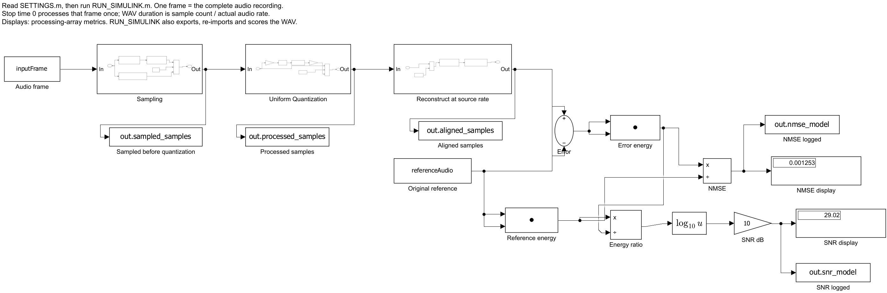
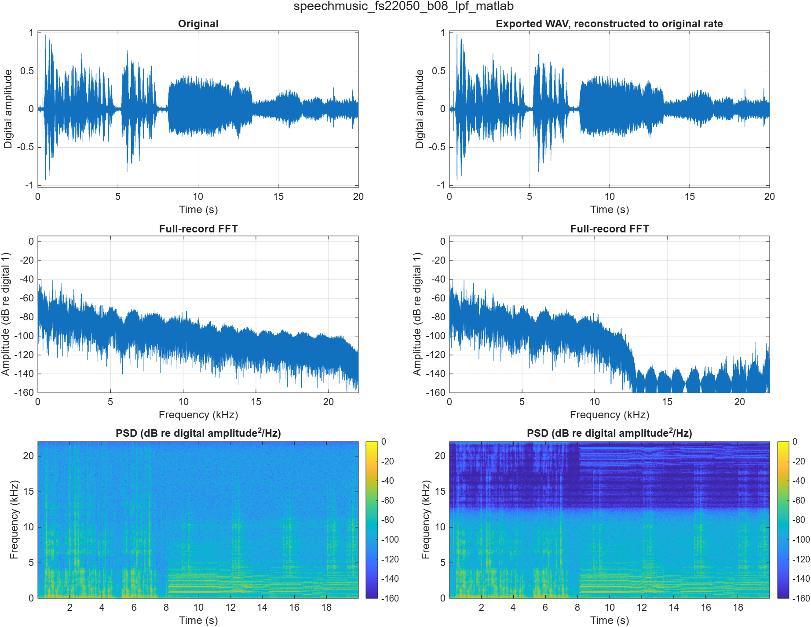
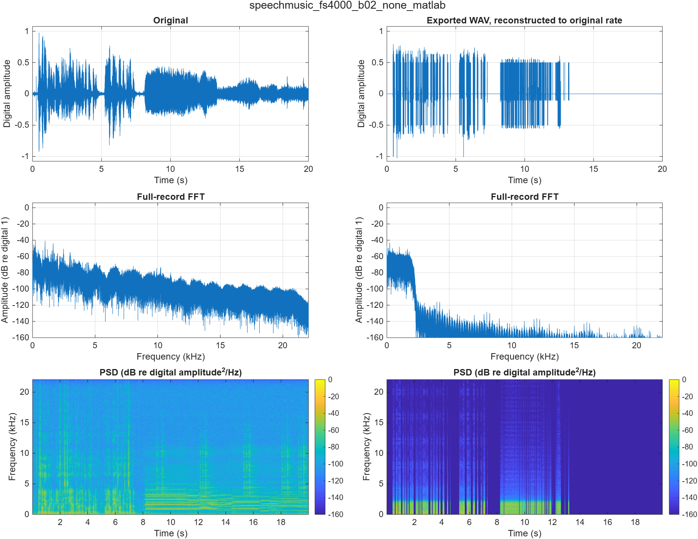
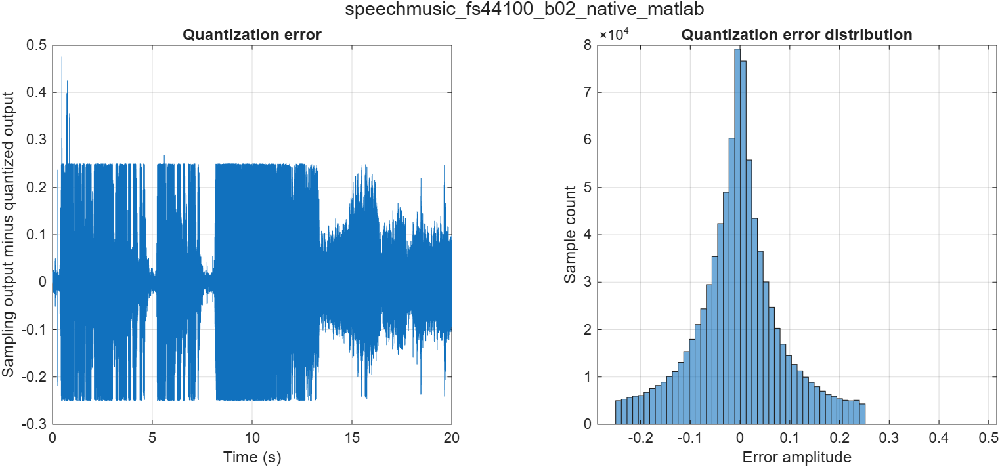

# Completed MATLAB and Simulink results

CCEN 302 | Jesher | 31 October 2026

This is the current complete objective-results section. The earlier three-control report is retained as history. All 36 conditions were generated and run independently in MATLAB and through the saved Simulink model, giving 72 actual result rows. No missing teammate output arrays were copied or relabeled as Simulink results.

## Method

The source is `Audios/SpeechMusic.wav`: mono, 44,100 Hz, 16-bit PCM, 882,005 samples (20.000113379 s). The rate set is 44,100, 22,050, 11,025, 8,000 and 4,000 Hz, with effective bits 16, 8, 4 and 2. Native-rate cases have one route; each lower rate has filtered and unfiltered routes. Both platforms use the same settings.

The filtered route uses a Kaiser-window FIR with n=10 and beta=5 and rational conversion p/q. The unfiltered route takes the original sample nearest each output time, with no low-pass filter. This is exact integer sample selection at 22,050/11,025 Hz and a documented nearest-source-time approximation at 8,000/4,000 Hz. No independent amplitude normalization is used.

The uniform signed quantizer uses step Delta=2/2^B, rounds to the nearest integer level, saturates its index to [-2^(B-1), 2^(B-1)-1], and multiplies by Delta. The 16-bit cases bypass further quantization as source/control cases. The visible Simulink implementation uses actual FIR Rate Conversion, Selector, Gain, Rounding Function and Saturation blocks.

Every processed array is exported at its actual output rate in a 16-bit PCM WAV. PCM conversion is explicitly nearest-integer rounding. The WAV is read back and reconstructed onto the original 44,100 Hz grid before subtracting. Known FIR/phase delay is compensated. The full original interval is retained: 882,005 samples, t=0 to 20.000090702948 s. Only deterministic end-grid rounding is discarded; there is no lag optimization, gain fitting or edge trimming.

`NMSE = sum((x-y).^2)/sum(x.^2)`; `SNR_dB = 10*log10(sum(x.^2)/sum((x-y).^2))`. The main table scores the **re-imported WAV**, while the CSV also records processing-array scores. Simulink displays calculate those processing-array scores inside the model. Positive-energy zero error gives NMSE=0/SNR=+Inf; silent-reference special cases are handled explicitly in `quality_metrics.m`.

## Full condition table

**Table 1.** Aligned quality scores of all 36 conditions on each platform, measured after WAV export/re-import. The two platforms have identical exported WAV scores for all conditions. Full precision is retained in `Results/metrics.csv`.

| Rate (Hz) | Bits | Filter | MATLAB NMSE | MATLAB SNR (dB) | Simulink SNR (dB) |
| --- | --- | --- | --- | --- | --- |
| 44100 | 16 | native | 0 | +Inf | +Inf |
| 44100 | 8 | native | 0.00046095 | 33.3635 | 33.3635 |
| 44100 | 4 | native | 0.10316 | 9.8649 | 9.8649 |
| 44100 | 2 | native | 0.736785 | 1.32659 | 1.32659 |
| 22050 | 16 | lpf | 0.000807225 | 30.9301 | 30.9301 |
| 22050 | 8 | lpf | 0.00125268 | 29.0216 | 29.0216 |
| 22050 | 4 | lpf | 0.101621 | 9.93017 | 9.93017 |
| 22050 | 2 | lpf | 0.732912 | 1.34948 | 1.34948 |
| 22050 | 16 | none | 0.0012202 | 29.1357 | 29.1357 |
| 22050 | 8 | none | 0.0016631 | 27.7908 | 27.7908 |
| 22050 | 4 | none | 0.101983 | 9.91473 | 9.91473 |
| 22050 | 2 | none | 0.732973 | 1.34912 | 1.34912 |
| 11025 | 16 | lpf | 0.01302 | 18.8539 | 18.8539 |
| 11025 | 8 | lpf | 0.0134703 | 18.7062 | 18.7062 |
| 11025 | 4 | lpf | 0.112719 | 9.48003 | 9.48003 |
| 11025 | 2 | lpf | 0.731212 | 1.35957 | 1.35957 |
| 11025 | 16 | none | 0.0239321 | 16.2102 | 16.2102 |
| 11025 | 8 | none | 0.0243771 | 16.1302 | 16.1302 |
| 11025 | 4 | none | 0.123362 | 9.08817 | 9.08817 |
| 11025 | 2 | none | 0.736254 | 1.32973 | 1.32973 |
| 8000 | 16 | lpf | 0.0251219 | 15.9995 | 15.9995 |
| 8000 | 8 | lpf | 0.0255641 | 15.9237 | 15.9237 |
| 8000 | 4 | lpf | 0.124191 | 9.0591 | 9.0591 |
| 8000 | 2 | lpf | 0.734668 | 1.33909 | 1.33909 |
| 8000 | 16 | none | 0.0495575 | 13.0489 | 13.0489 |
| 8000 | 8 | none | 0.0500332 | 13.0074 | 13.0074 |
| 8000 | 4 | none | 0.148882 | 8.27158 | 8.27158 |
| 8000 | 2 | none | 0.745928 | 1.27303 | 1.27303 |
| 4000 | 16 | lpf | 0.122593 | 9.11536 | 9.11536 |
| 4000 | 8 | lpf | 0.123038 | 9.09962 | 9.09962 |
| 4000 | 4 | lpf | 0.218377 | 6.60792 | 6.60792 |
| 4000 | 2 | lpf | 0.784611 | 1.05345 | 1.05345 |
| 4000 | 16 | none | 0.230816 | 6.36735 | 6.36735 |
| 4000 | 8 | none | 0.231309 | 6.35807 | 6.35807 |
| 4000 | 4 | none | 0.325383 | 4.87605 | 4.87605 |
| 4000 | 2 | none | 0.840092 | 0.756734 | 0.756734 |

Maximum MATLAB/Simulink processing-sample difference across all pairs: **7.77156117238e-16** (tolerance 1e-10). Numerical accumulation differences were removed by the PCM conversion in these tested exports; this is a measured result for the present implementation and source, not universal platform equivalence.

## Interpretation

At the native rate, reducing effective bits increases error and reduces SNR. For example, native 8-bit and 2-bit cases have SNRs of 33.3635 and 1.3266 dB. Filtering before rate reduction generally improves the high-precision sampling controls: at 4,000 Hz and 16-bit control precision, filtered/unfiltered SNRs are 9.1154/6.3673 dB. Low-bit quantization can dominate the total error, so the effect of filtering is smaller and need not be monotonic in every low-bit case. The approximate 6 dB/bit rule assumes a suitable ideal quantization-noise model; it is not imposed on this speech/music recording or on saturated low-bit levels.

## Representative figures

**Figure 1.** Saved `Audio_Demo.slx` processing diagram. Sampling, uniform quantization and reconstruction are explicit subsystems. The reference and reconstructed processing arrays feed Simulink energy calculations and NMSE/SNR displays. One frame is the complete recording; model stop time 0 evaluates that frame once and is not the WAV duration. MATLAB then writes and evaluates the WAV.

**Figure 2.** Combined 22,050 Hz, 8-bit filtered case: original (left) and re-imported WAV reconstructed to the original grid (right). Rows show waveform, full-record single-sided FFT magnitude and one-sided PSD spectrogram. The envelope and main low-frequency structure remain recognizable while higher frequencies are attenuated. NMSE=0.00125267620062; SNR=29.02161174 dB.

**Figure 3.** Combined 4,000 Hz, 2-bit unfiltered case with the same panel ordering as Figure 2. The low effective precision coarsens the waveform and the retained bandwidth is greatly reduced. Reconstruction can suppress images but cannot undo aliasing that occurred during unfiltered sampling. NMSE=0.840091506062; SNR=0.75673406 dB. Audible descriptors require actual listening.

**Figure 4.** Native-rate 2-bit quantization error (sampling output minus quantized output) and its sample histogram. Low-bit saturation can produce errors larger than half a quantizer step; a uniform-noise distribution is not assumed. This plot isolates quantization error at the same time base.

The waveform/FFT display retains extrema in dense display bins for drawing speed; the full signal is used in every FFT and metric. Spectrogram settings for this source are periodic Hann 1,024 samples, 768 overlap, 2,048 DFT points, 44,100 Hz analysis rate, and PSD color limits -160 to 0 dB. FFT amplitudes are divided by the full record length, paired positive-frequency bins are doubled, and a -160 dB display floor is used. These digital dB values are not calibrated sound-pressure levels.

## Audio and storage

All 72 case WAVs passed actual rate, mono channel count, 16-bit container, sample-count and file-size checks. No export clipping occurred. There are 73 audio files in `Results/all_audio.zip`: the unchanged original plus 72 platform-labeled outputs. The accompanying 73-row audio manifest and every ZIP member were checked against the files byte for byte.

**Table 2.** Actual WAV sizes by rate (the four effective bit depths use the same 16-bit carrier). Ideal packed payload is `ceil(samples*effective_bits/8)` bytes for mono audio; it is distinct from these measured container sizes.

| Rate (Hz) | Samples | Duration (s) | Actual WAV bytes |
| --- | --- | --- | --- |
| 44100 | 882005 | 20.000113379 | 1764054 |
| 22050 | 441003 | 20.000136054 | 882050 |
| 11025 | 220502 | 20.000181406 | 441048 |
| 8000 | 160001 | 20.000125000 | 320046 |
| 4000 | 80001 | 20.000250000 | 160046 |

Each current WAV has 44 bytes beyond its two-byte-per-mono-sample PCM payload. Changing effective bits alone does not shrink these WAVs. Rate reduction changes the actual sample payload. Sample-count rounding accounts for the tiny differences in N/Fs durations; changing a WAV header alone is not rate conversion.

## Listening and remaining human work

Jesher previously reported the original and the two earlier 22,050 Hz sampling controls as audible and clear. That observation is retained in `../listening/initial_observation.md`. It does not establish listening to the new 72 exports, especially the reduced-bit/combined cases. No new subjective observations, four-person comparison, speaker routing/speed confirmation, reviewer acceptance or rehearsal are invented here.

Numerical implementation, the full matrix, export/ZIP generation, plots and the live-demo entry points are complete with the available resources. The team still needs to listen to the new outputs, collect each person's notes with a fixed setup, confirm microphone provenance, review the chosen conventions and rehearse the live presentation. This self-contained demo was implemented here; it is not claimed as independently produced or accepted by another teammate.

## Known-tone alias check

The optional `DEMONSTRATE_ALIASING.m` uses the existing 10 kHz sine recording and an 8 kHz output rate. The expected fold is `abs(10000-8000)=2000 Hz`. The measured dominant unfiltered output frequency was **2000.000 Hz**. The peak check omits 0.1 s at each edge only for tone-frequency inspection; all NMSE/SNR calculations still retain their full comparison intervals.
