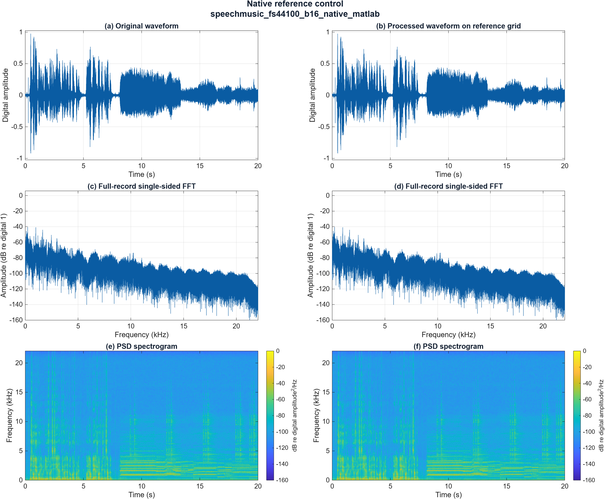
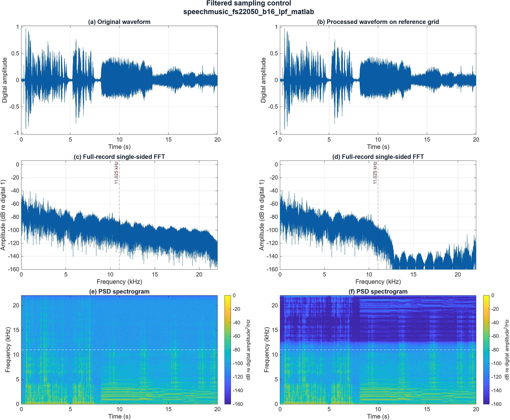
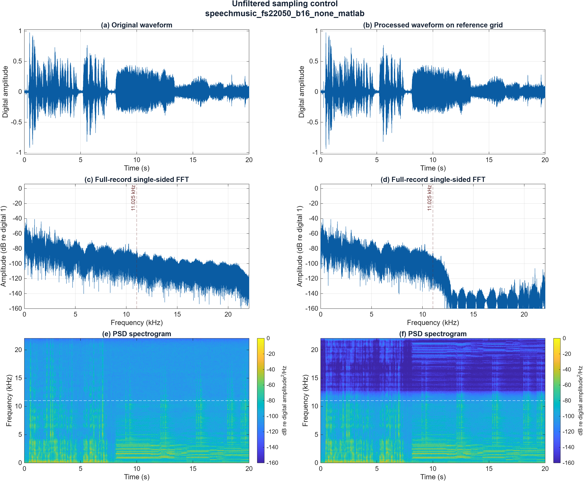

# MATLAB quality metrics, audio output and listening results

**CCEN 302 - Jesher | Report section prepared 31 October 2026**

Measured run: 30 October 2026, 17:02:11 Asia/Dubai. MATLAB R2026b Update 1. This section completes the presentation of the three currently available MATLAB controls; the full MATLAB/Simulink experiment remains incomplete.

**Table 1. Evaluated mono signals and actual sample counts.**

| Condition | Rate (Hz) | Samples | Duration N/Fs (s) |
| --- | --- | --- | --- |
| Native reference | 44,100 | 882,005 | 20.000113379 |
| Filtered (lpf) | 22,050 | 441,003 | 20.000136054 |
| Unfiltered (none) | 22,050 | 441,003 | 20.000136054 |

Input: Audios/SpeechMusic.wav, mono 44,100 Hz, 16-bit PCM. The lower-rate arrays are sampling-only double-precision outputs. Their b16 identifiers refer to source/control precision; no additional quantizer was applied.

**Table 2. Total processing error before WAV conversion, on the aligned original grid.**

| Condition | NMSE | SNR (dB) | Metric status |
| --- | --- | --- | --- |
| Native reference | 0 | +Inf | unchanged |
| Filtered (lpf) | 0.000807222473989 | 30.93006755 | finite |
| Unfiltered (none) | 0.00122019794119 | 29.13569712 | finite |

The filtered case has 1.7944 dB higher SNR and 33.84% lower NMSE than the unfiltered case for this recording and comparison policy. These are objective error comparisons, not a measured listening preference. The unchanged control has zero error and therefore +Inf SNR by definition.

Coverage: **3/36 MATLAB cases and 0/36 Simulink cases** evaluated by this run. The remaining 69 entries are explicitly missing, rather than assigned estimated scores.

<!-- pagebreak -->

## Comparison and analysis method

### Alignment and metric definitions

Let E_reference = sum(x[n]^2), and E_error = sum((x[n] - y_aligned[n])^2), where both arrays represent the same physical times. The implemented measures are:

**NMSE = E_error / E_reference** **SNR_dB = 10 log10(E_reference / E_error)**

For positive reference and error energies, SNR_dB = -10 log10(NMSE). Unchanged nonzero input gives NMSE = 0 and SNR = +Inf. Zero reference and zero error give NaN/NaN; zero reference with positive error gives +Inf/-Inf. Explicit statuses distinguish these cases; no epsilon is inserted to manufacture a finite score.

AA03 alignment reconstructs each 22,050 Hz array using resample(y,2,1,10,5). This yields 882,006 samples; only the final unmatched endpoint is discarded. All 882,005 original samples are compared, from t = 0 to 20.000090702948 s. No extra edge trimming, lag search, fitted gain or independent normalization is used. Existing MATLAB FIR delay compensation is not repeated.

The filtered producer uses resample(x,1,2,10,5), a 41-tap FIR (order 40), Kaiser beta = 5, with its delay compensated. The unfiltered producer selects x(1:2:end) directly. Reference and processing arrays are retained in evaluation.mat and the producer handoff is copied into input_snapshot/.

**Table 3. Matched figure settings applied to original and reconstructed signals.**

| Analysis | Settings |
| --- | --- |
| Waveform | Full comparison interval; common amplitude limits within each figure. |
| FFT | Full-record N = 882,005; divide magnitude by N; double paired positive-frequency bins; no extra taper. |
| FFT scale | 20 log10(amplitude); reference digital amplitude 1; display floor -160 dB. |
| Spectrogram | Periodic Hann window: 1,024 samples; overlap: 768 (75%); hop: 256; DFT: 2,048; analysis rate: 44,100 Hz. |
| PSD scale | One-sided PSD; 10 log10(PSD), digital amplitude squared per Hz; color limits -160 to 0 dB. |

The spectrogram window spans approximately 23.22 ms and its hop is 5.805 ms; the DFT-bin spacing is 21.5332 Hz. Bin spacing is not a claim of independent frequency resolution. All displayed dB levels are digital measures, not calibrated sound-pressure levels.

<!-- pagebreak -->

## Native reference: unchanged 44,100 Hz control

**Figure 1.** Native reference control, speechmusic_fs44100_b16_native_matlab. Panels (a,c,e) show the original; (b,d,f) show the unchanged control. Rows show waveform, single-sided FFT magnitude and PSD spectrogram. Both columns use the 44,100 Hz grid and the matched settings in Table 3. No rate conversion or additional quantization is applied.

**Waveform.** Both columns preserve the same approximately 20-second envelope, early transients and later sustained sections. They coincide because the samples are identical, not merely because the plot appears similar.

**FFT and spectrogram.** The spectra and time-frequency patterns coincide. The strongest plotted components are concentrated toward lower frequencies, with weaker upper-frequency content. Later horizontal bands indicate sustained harmonic structure. This control produces NMSE = 0 and SNR = +Inf; neither value establishes the acoustic noise level of the original recording.

<!-- pagebreak -->

## Filtered sampling: 44,100 to 22,050 Hz

**Figure 2.** Filtered sampling control, speechmusic_fs22050_b16_lpf_matlab. Original panels (a,c,e) are compared with processed panels (b,d,f) after reconstruction to 44,100 Hz. Dashed lines mark the reduced-rate Nyquist frequency, 11.025 kHz. The 22,050 Hz processing array contains 441,003 samples; the plotted comparison retains all 882,005 original sample times.

**Waveform.** The principal envelope, transient timing and quieter intervals remain visually similar at the full-record scale. This appearance does not establish sample identity; the nonzero metric error quantifies the difference.

**FFT and spectrogram.** Dominant lower-frequency structure is retained, while the spectrum rolls off near the reduced-rate Nyquist region and upper-band spectrogram power is strongly attenuated. The finite filter transition means this is not an ideal brick-wall cutoff. The displayed spectrum includes both the producer anti-aliasing filter and the subsequent reconstruction filter. Weak residual upper-band features do not demonstrate recovery of lost source content.

Before WAV conversion: **NMSE = 0.000807222473989; SNR = 30.93006755 dB.**

<!-- pagebreak -->

## Unfiltered sampling: 44,100 to 22,050 Hz

**Figure 3.** Unfiltered sampling control, speechmusic_fs22050_b16_none_matlab. The producer selects every second original sample without prefiltering. Processed panels (b,d,f) are nevertheless reconstructed using a low-pass interpolation filter for comparison. Dashed lines mark 11.025 kHz; settings and panel ordering match Figure 2.

**Waveform.** The overall envelope and major events remain close to the original at this scale. Frequency-content changes can be present even when a full-record waveform comparison appears similar.

**FFT and spectrogram.** Upper-frequency attenuation is visible in the reconstructed result. It does not prove that anti-aliasing filtering preceded downsampling: the reconstruction itself suppresses high-frequency images. Original components above 11.025 kHz can fold into the retained band during unfiltered downsampling; reconstruction cannot reverse that folding. These broadband plots do not isolate a particular folded tone, so no specific alias frequency is claimed. Clear tone-based folding evidence remains separate work.

Before WAV conversion: **NMSE = 0.00122019794119; SNR = 29.13569712 dB.**

<!-- pagebreak -->

## Audio export, measured file sizes and listening

Each processed array was written at its actual rate into a mono 16-bit PCM WAV without independent normalization. Re-import checks recorded zero clipped samples, matching rates/counts and conversion errors no larger than one PCM16 step (1/32768). The source file is retained unchanged as original/SpeechMusic.wav.

**Table 4. WAV conversion error and quality measured after re-import.**

| Condition | Max. sample error | RMS sample error | WAV NMSE | WAV SNR (dB) |
| --- | --- | --- | --- | --- |
| Native reference | 0 | 0 | 0 | +Inf |
| Filtered (lpf) | 3.0517304e-05 | 1.7613853e-05 | 0.0008072522247 | 30.92990749 |
| Unfiltered (none) | 0 | 0 | 0.001220197941 | 29.13569712 |

The filtered double array incurs a small additional PCM conversion error. The native and direct-selection arrays are already representable on the PCM16 grid and round-trip without sample error. Table 2 and Table 4 therefore describe distinct signal representations.

**Table 5. Actual exported sizes; every WAV uses a 16-bit mono container.**

| File role | Rate (Hz) | Samples | File bytes |
| --- | --- | --- | --- |
| Retained original | 44,100 | 882,005 | 1,764,054 |
| Native reference | 44,100 | 882,005 | 1,764,054 |
| Filtered (lpf) | 22,050 | 441,003 | 882,050 |
| Unfiltered (none) | 22,050 | 441,003 | 882,050 |

Each listed WAV has 44 bytes beyond its PCM sample payload (2 bytes per mono sample). The reduced-rate WAVs are approximately half the original file size. These are measured container sizes, not evidence of a reduced-bit quantizer.

### Initial listening observation

Jesher reported that the original and both 22,050 Hz recordings were **audible and clear**. No specific hiss, harshness, muffling or perceptual ranking was reported. This one-listener observation is compatible with measurable processing error; it does not establish perceptual identity or a preference for either reduced-rate case.

The exact session time, device/routing, volume, playback gain, excerpt and intended-speed confirmation were not explicitly reported. Other teammates' listening observations are not available. These details remain unconfirmed rather than being inferred from the playback instructions.

<!-- pagebreak -->

## Evidence, boundaries and remaining work

**Supported conclusion.** For the present recording, the filtered sampling control has lower aligned error than direct unfiltered downsampling, while both retain a recognizable waveform envelope and were reported audible and clear by Jesher. The unchanged control behaves as expected. The current evidence supports these three cases only.

**Table 6. Current evaluation coverage.**

| Platform | Evaluated | Still missing |
| --- | --- | --- |
| MATLAB | 3 of 36 | 33 |
| Simulink | 0 of 36 | 36 |
| Total | 3 of 72 | 69 |

Reduced-bit and combined cases, remaining sample rates and matching Simulink arrays are not evaluated here. No platform-parity result or 6 dB/bit finding is inferred from these controls. Microphone acquisition provenance remains the baseline owner's outstanding confirmation. Full listening coverage, technical review and final package sign-off remain open.

All 19 MATLAB test methods passed with no failed or incomplete cases in the saved session diary. This is numerical and integration-test evidence. The run summary's automated playback/listening flags remain false; the user's later audible/clear observation is recorded separately. The archive audio_partial_NOT_FINAL.zip contains the retained original, three processed WAVs, manifest and coverage CSV. Its exact file set and member bytes were rechecked for this report; the ZIP is not a full-project submission package.

### Traceability

Run folder: Jesher/results/matlab_run_20261030_170138_859/. Numerical source: metrics.csv. WAV source: audio_package/manifest.csv. Metadata: run_summary.json. Exact arrays: evaluation.mat. Producer snapshot: input_snapshot/001_sampling_22050.mat. Test evidence: Jesher/results/matlab_session_20261030_170012.txt. Listening evidence: Jesher/listening/initial_observation.md.

Native reference: speechmusic_fs44100_b16_native_matlab. Export: processed/speechmusic_fs44100_b16_native_matlab.wav.

Filtered (lpf): speechmusic_fs22050_b16_lpf_matlab. Export: processed/speechmusic_fs22050_b16_lpf_matlab.wav.

Unfiltered (none): speechmusic_fs22050_b16_none_matlab. Export: processed/speechmusic_fs22050_b16_none_matlab.wav.

Source checkout: be17af9179ecc91a2e8c2a50f606d82070afe503. The local Jesher implementation was uncommitted when this run was made; the checkout ID is not a commit identifier for the new evaluation code. Report figures were regenerated from the saved arrays with readable labels; original run figures and numeric results were not overwritten.

### Method references

MathWorks, resample: https://www.mathworks.com/help/signal/ref/resample.html. MathWorks, spectrogram: https://www.mathworks.com/help/signal/ref/spectrogram.html. Checked 31 October 2026. These references explain API behavior; the numeric results above come from the saved MATLAB run.
