# Sampling and aliasing report draft

## Sampling and aliasing

**Abdulrahman | MATLAB report section draft | 1 November 2026**

The same mono speech/music recording was converted from 44.1 kHz to four lower rates, with and without anti-aliasing low-pass filtering. Eight MATLAB sampling cases are supplied. A known 10 kHz tone folds to 1,025 Hz after unfiltered conversion to 11.025 kHz, matching the sampling-theory prediction. Filtering reduces the measured largest residual by 68.74 dB relative to the unfiltered alias.

### Reference recording

The source WAV contains 882,005 mono samples at 44,100 Hz, stored as 16-bit PCM. Its sample-count duration is 20.000113379 s. Yazan's baseline waveform, FFT and spectrogram analysis supplies the original reference [1, 2]. The WAV header establishes its digital format; microphone-acquisition provenance belongs to Yazan's acquisition record.

| Output Hz | Nyquist Hz | Ratio p/q | Samples per path | Duration s |
| --- | --- | --- | --- | --- |
| 22,050 | 11,025.0 | 1/2 | 441,003 | 20.000136054 |
| 11,025 | 5,512.5 | 1/4 | 220,502 | 20.000181406 |
| 8,000 | 4,000.0 | 80/441 | 160,001 | 20.000125000 |
| 4,000 | 2,000.0 | 40/441 | 80,001 | 20.000250000 |

### Scope of this section

These are sampling-only results. The MAT arrays retain double-valued samples without reduced-bit quantization or independent normalization. The b16 label identifies the source/control; WAV playback copies use a 16-bit PCM carrier. Quantization, complete NMSE/SNR tables and listening results belong to the integrated team evaluation.

New-rate Simulink implementation and comparison remain pending. The previously verified 22.05 kHz platform comparison is retained [7]. This is a draft section for the team report, not a completed submission report.

## Sampling methods

### Integer conversions

```matlab
yNoFilter = x(1:2:end);       % 22,050 Hz
yNoFilterRate = x(1:4:end);   % 11,025 Hz
```

Index 1 retains t=0; the step retains every second or fourth measurement. No anti-aliasing low-pass filter is applied. The resulting arrays must be associated with their actual lower rates. Changing a sampling-rate label alone would change playback speed.

### Non-integer conversions

```matlab
[p, q] = rat(FsOutput / Fs);
outputTime = (0:lastOutputIndex)' / FsOutput;
yNoFilterRate = interp1(originalTime, x, outputTime, "linear");
```

The exact ratios are 80/441 for 8 kHz and 40/441 for 4 kHz. A constant integer indexing step cannot give either exact rate. Linear interpolation estimates values at uniform target times between surrounding source samples. It changes the frequency response, but supplies no dedicated anti-aliasing low-pass filter at the new Nyquist limit. Differences from the filtered path therefore include interpolation-method effects as well as anti-aliasing effects.

### Filtered conversion

```matlab
[yFilteredRate, coefficientsRate] = resample(x, p, q, 10, 5);
```

resample uses a Kaiser-window FIR design with n=10 and beta=5, and compensates its designed delay. Every branch starts from the original x. Filtering after unfiltered downsampling cannot undo folding. A finite filter has a transition band rather than a perfect frequency wall [3, 4].

| Output Hz | FIR taps | Coefficient rate Hz | Nominal cutoff Hz |
| --- | --- | --- | --- |
| 22,050 | 41 | 44,100 | 11,025 |
| 11,025 | 81 | 44,100 | 5,512.5 |
| 8,000 | 8,821 | 3,528,000 | 4,000 |
| 4,000 | 8,821 | 1,764,000 | 2,000 |

For p greater than 1, coefficients describe the intermediate upsampled grid at p times the source rate. They are not ordinary source-rate FIR Decimation coefficients. Polyphase processing avoids explicitly allocating a zero-inserted audio array.

## Alignment and analysis settings

### Match physical times

All cases start at t=0. The 8 and 4 kHz grids end at 20.000000000 s, slightly before the original final timestamp of 20.000090703 s. The filtered arrays are retained on the same grids as their unfiltered counterparts. Sample-count duration N/Fs differs from last sample time (N-1)/Fs by one sample interval.

```matlab
reconstructed = resample(entry.samples, entry.q, entry.p);
aligned = reconstructed(1:length(reference));
```

The inverse ratio restores the 44.1 kHz comparison grid, not lost or aliased information. Every current case was checked to reconstruct to at least 882,005 samples, then the full original interval is retained. Do not shift again after resample's delay compensation. No independent normalization, optimized lag shift or error-based edge trimming is applied. Reconstruction boundary effects remain in later quality measurements, including the short tail beyond the final lower-rate sample.

### Waveforms and FFTs

Full waveforms use actual sample times and common amplitude limits. The same 10 ms interval centered on the source's largest sample is enlarged in all comparisons. Full-record FFT magnitudes are divided by N. Paired positive-frequency magnitudes are doubled, leaving DC and any exact Nyquist bin unchanged. Frequency labels use each array's actual rate. The dB view is 20 log10 of amplitude relative to 1. A plotting floor of 1e-12 prevents log10(0), without changing stored samples.

### Spectrograms

Hamming windows last approximately 30 ms with approximately 20 ms overlap; sample counts are rounded at each rate. Every FFT has 2,048 points. Fixed color limits are -130 to -30 dB relative to 1 numeric sample-unit squared per Hz. All three rows show the shared output band from zero to the new Nyquist limit; the full-band FFT shows original content above that limit. Padding adds grid points, not physical resolving power. The kHz axis does not change density units from per Hz to per kHz.

### Existing platform validation

At 22.05 kHz, the known causal FIR delay is 10 output samples. Recorded speech/music MATLAB-versus-Simulink differences were 0 without filtering and 3.33066907388e-16 with filtering. The earlier 300 Hz tone had zero residual reconstruction lag. These are implementation-agreement checks, not NMSE/SNR against the original [7].

## Known frequency aliasing

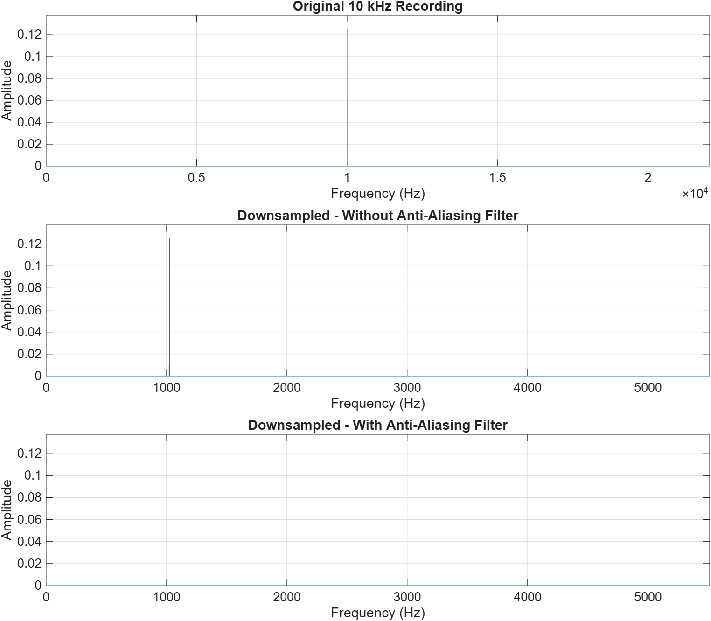

**Figure 1.** Existing 10 kHz sine recording and factor-four conversion to 11.025 kHz, using the same amplitude scale. The new Nyquist limit is 5,512.5 Hz.

| Signal | Largest peak Hz | Peak amplitude |
| --- | --- | --- |
| original | 10,000.00 | 0.124972988 |
| none | 1,025.00 | 0.124972988 |
| lpf | 1,025.00 | 0.000045683 |

Without filtering, 10,000 Hz folds to |11,025 - 10,000| = 1,025 Hz. These cosine frequencies are indistinguishable at the retained sampling times. The anti-aliasing path reduces the largest residual by 68.74 dB; a practical filter leaves a small residual rather than exact zero. Measurements come from Aliasing_Demo.m and the existing tone [5, 6].

## 22,050 Hz waveform comparison


**Figure 2.** Full recording at left and a common active 10 ms interval at right. Each row uses its actual sampling rate and equal amplitude limits. The lower-rate plotted samples are farther apart in time. Lines join points for readability.

Both processed paths contain 441,003 samples at 22,050 Hz, with duration N/Fs = 20.000136054 s. Fewer samples do not imply faster or slower intended playback.

### Interpreting the waveform

A similar overall envelope locates events at similar times, but does not establish equal frequency content or identical samples. The common excerpt reveals local shape changes. Later error measurements must reconstruct to the agreed reference grid before subtracting arrays.

## 22,050 Hz spectrum comparison

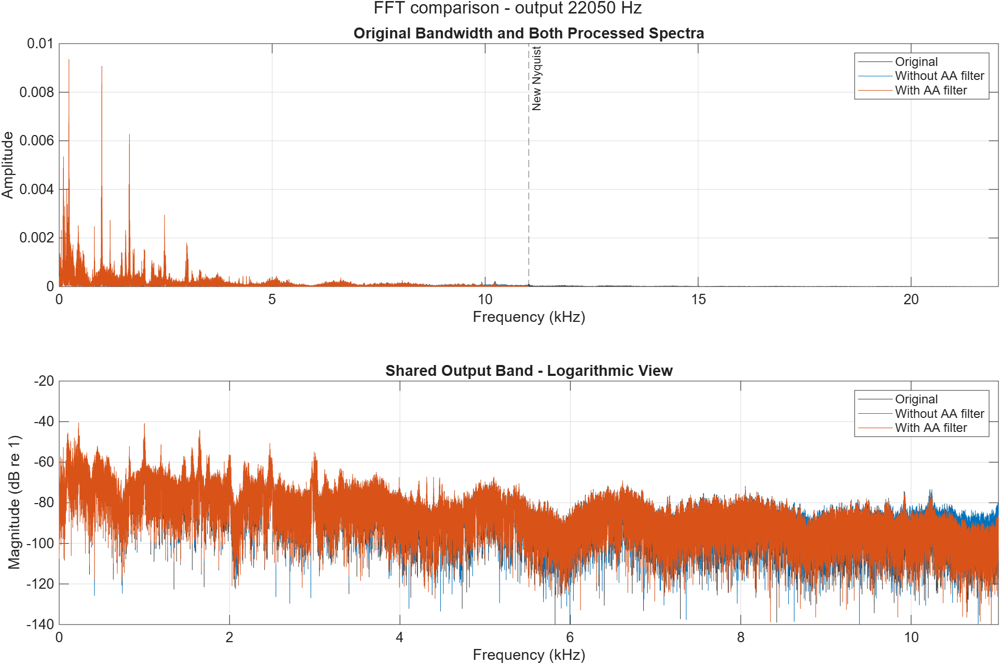

**Figure 3.** The upper panel shows the original bandwidth and marks the new Nyquist boundary at 11,025.0 Hz. Processed spectra stop at their own representable limits. The lower panel compares the shared output band in dB relative to amplitude 1.

The strong low-frequency peaks are close between paths. Weak-component differences are easier to inspect in the logarithmic panel. Much of the dominant visible content lies below the new limit. Close linear spectra alone do not establish that no aliasing occurred.

### Interpreting the overlap

An aliased component appears inside the remaining band, not at its original out-of-band frequency. Filtering before rate reduction suppresses the high-frequency contribution. Original spectral content and the finite filter transition determine the observed differences. Magnitude overlap alone does not establish phase or waveform agreement.

## 22,050 Hz spectrogram comparison

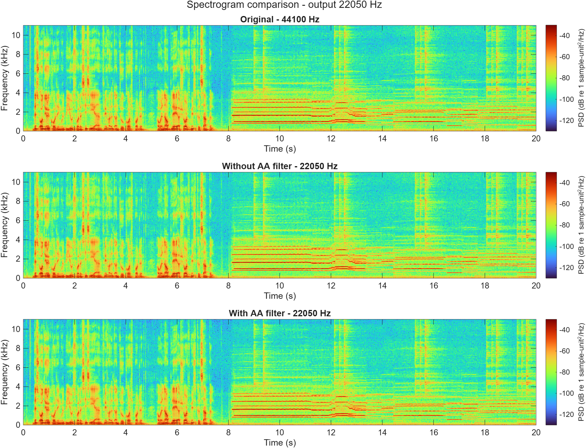

**Figure 4.** All rows use 30 ms Hamming windows, 20 ms overlap and 2,048 FFT points. The output Nyquist limit is 11,025.0 Hz. The unchanged original is displayed over the same output band as both processed rows, with equal color limits. Original frequencies above that limit remain visible in the full-band FFT figure.

Horizontal bands indicate sustained components. Changes over time indicate changing spectral content. Compare matching time-frequency locations within the output band. These views complement the FFT comparisons, but cannot independently identify the source frequency of every output feature.

Color values are numeric power spectral density, not calibrated acoustic dB SPL. Smaller rate means fewer samples in a 30 ms window; window durations, rather than sample counts, are matched across cases.

## 11,025 Hz waveform comparison


**Figure 5.** Full recording at left and a common active 10 ms interval at right. Each row uses its actual sampling rate and equal amplitude limits. The lower-rate plotted samples are farther apart in time. Lines join points for readability.

Both processed paths contain 220,502 samples at 11,025 Hz, with duration N/Fs = 20.000181406 s. Fewer samples do not imply faster or slower intended playback.

### Interpreting the waveform

A similar overall envelope locates events at similar times, but does not establish equal frequency content or identical samples. The common excerpt reveals local shape changes. Later error measurements must reconstruct to the agreed reference grid before subtracting arrays.

## 11,025 Hz spectrum comparison

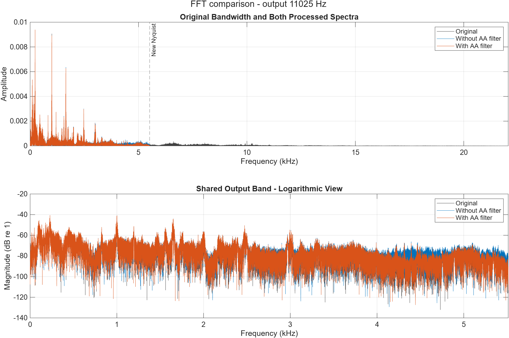

**Figure 6.** The upper panel shows the original bandwidth and marks the new Nyquist boundary at 5,512.5 Hz. Processed spectra stop at their own representable limits. The lower panel compares the shared output band in dB relative to amplitude 1.

Dominant low-frequency peaks remain close. Differences in the weaker upper output band are consistent with the changed anti-aliasing treatment. The separate 10 kHz tone experiment identifies an exact 1,025 Hz folding example at this rate.

### Interpreting the overlap

An aliased component appears inside the remaining band, not at its original out-of-band frequency. Filtering before rate reduction suppresses the high-frequency contribution. Original spectral content and the finite filter transition determine the observed differences. Magnitude overlap alone does not establish phase or waveform agreement.

## 11,025 Hz spectrogram comparison

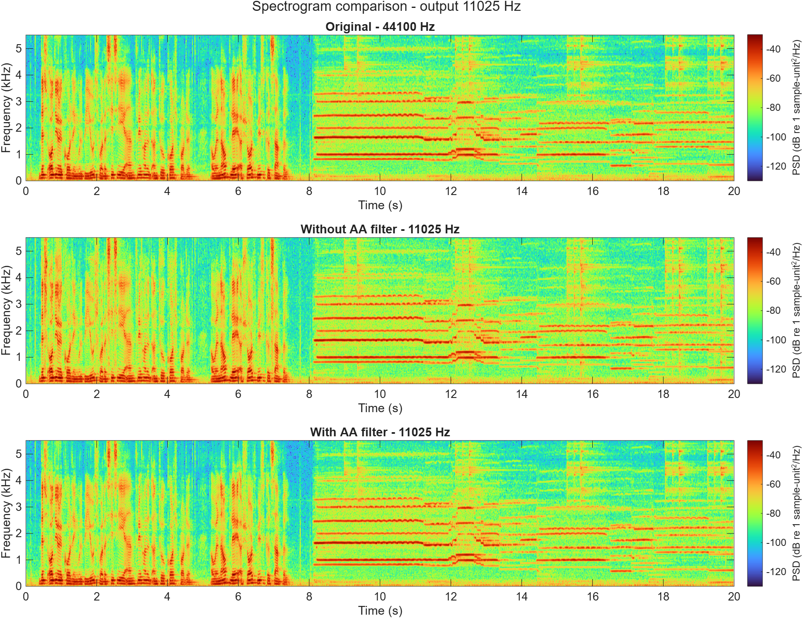

**Figure 7.** All rows use 30 ms Hamming windows, 20 ms overlap and 2,048 FFT points. The output Nyquist limit is 5,512.5 Hz. The unchanged original is displayed over the same output band as both processed rows, with equal color limits. Original frequencies above that limit remain visible in the full-band FFT figure.

Horizontal bands indicate sustained components. Changes over time indicate changing spectral content. Compare matching time-frequency locations within the output band. These views complement the FFT comparisons, but cannot independently identify the source frequency of every output feature.

Color values are numeric power spectral density, not calibrated acoustic dB SPL. Smaller rate means fewer samples in a 30 ms window; window durations, rather than sample counts, are matched across cases.

## 8,000 Hz waveform comparison

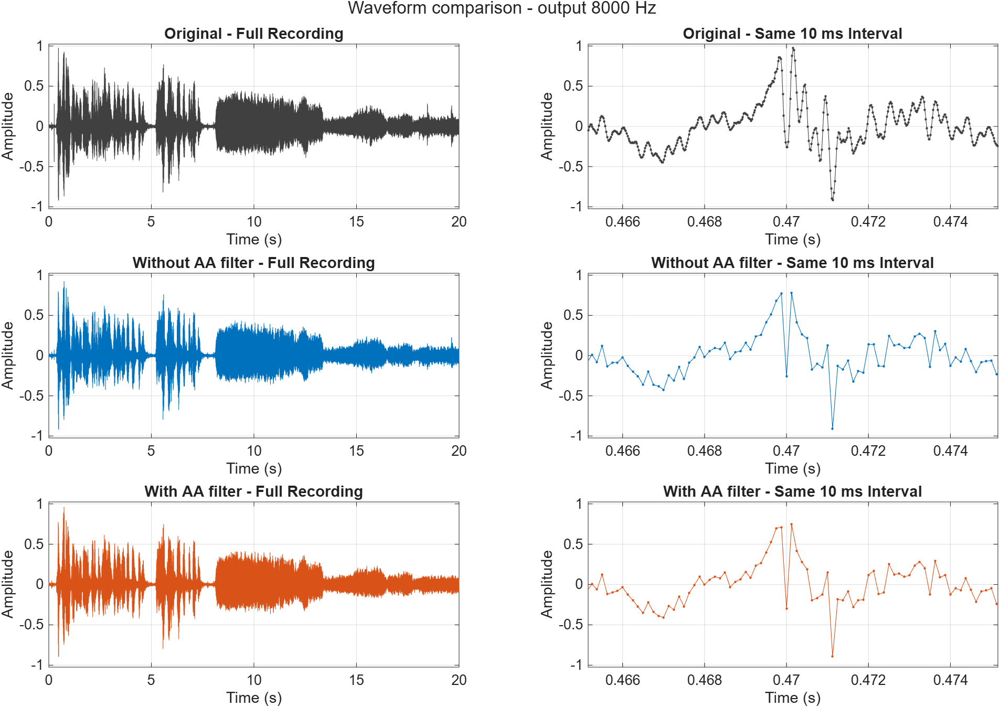

**Figure 8.** Full recording at left and a common active 10 ms interval at right. Each row uses its actual sampling rate and equal amplitude limits. The lower-rate plotted samples are farther apart in time. Lines join points for readability.

Both processed paths contain 160,001 samples at 8,000 Hz, with duration N/Fs = 20.000125000 s. Fewer samples do not imply faster or slower intended playback.

### Interpreting the waveform

A similar overall envelope locates events at similar times, but does not establish equal frequency content or identical samples. The common excerpt reveals local shape changes. Later error measurements must reconstruct to the agreed reference grid before subtracting arrays.

## 8,000 Hz spectrum comparison

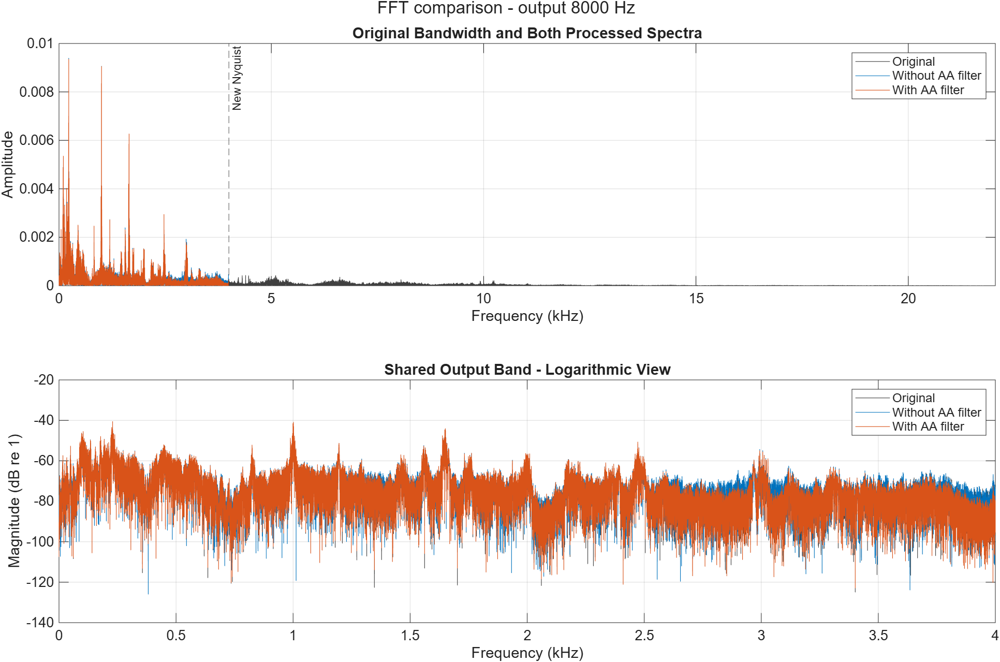

**Figure 9.** The upper panel shows the original bandwidth and marks the new Nyquist boundary at 4,000.0 Hz. Processed spectra stop at their own representable limits. The lower panel compares the shared output band in dB relative to amplitude 1.

The output bandwidth is limited to 4 kHz. Many low-frequency peaks remain close while differences appear in weaker components. Linear interpolation in the unfiltered route changes amplitudes too, so not every difference can be attributed only to folded energy.

### Interpreting the overlap

An aliased component appears inside the remaining band, not at its original out-of-band frequency. Filtering before rate reduction suppresses the high-frequency contribution. Original spectral content and the finite filter transition determine the observed differences. Magnitude overlap alone does not establish phase or waveform agreement.

## 8,000 Hz spectrogram comparison

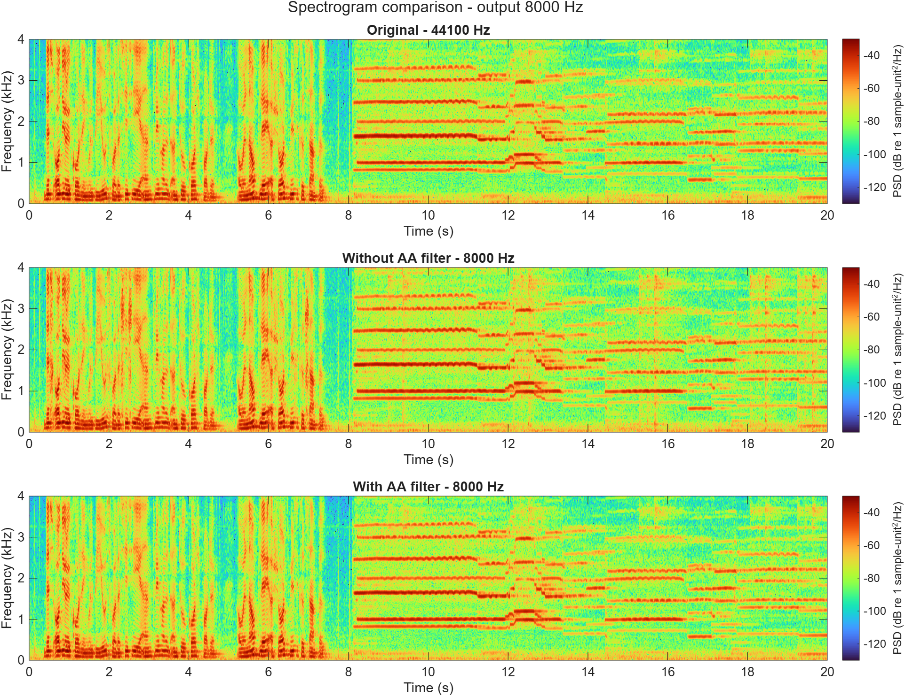

**Figure 10.** All rows use 30 ms Hamming windows, 20 ms overlap and 2,048 FFT points. The output Nyquist limit is 4,000.0 Hz. The unchanged original is displayed over the same output band as both processed rows, with equal color limits. Original frequencies above that limit remain visible in the full-band FFT figure.

Horizontal bands indicate sustained components. Changes over time indicate changing spectral content. Compare matching time-frequency locations within the output band. These views complement the FFT comparisons, but cannot independently identify the source frequency of every output feature.

Color values are numeric power spectral density, not calibrated acoustic dB SPL. Smaller rate means fewer samples in a 30 ms window; window durations, rather than sample counts, are matched across cases.

## 4,000 Hz waveform comparison

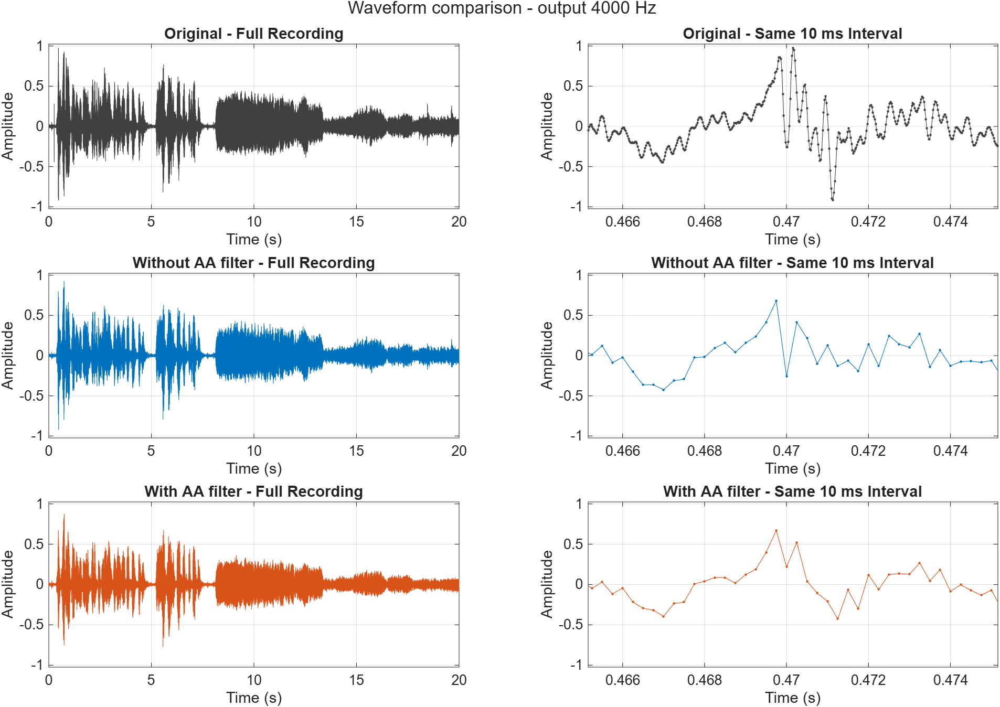

**Figure 11.** Full recording at left and a common active 10 ms interval at right. Each row uses its actual sampling rate and equal amplitude limits. The lower-rate plotted samples are farther apart in time. Lines join points for readability.

Both processed paths contain 80,001 samples at 4,000 Hz, with duration N/Fs = 20.000250000 s. Fewer samples do not imply faster or slower intended playback.

### Interpreting the waveform

A similar overall envelope locates events at similar times, but does not establish equal frequency content or identical samples. The common excerpt reveals local shape changes. Later error measurements must reconstruct to the agreed reference grid before subtracting arrays.

## 4,000 Hz spectrum comparison

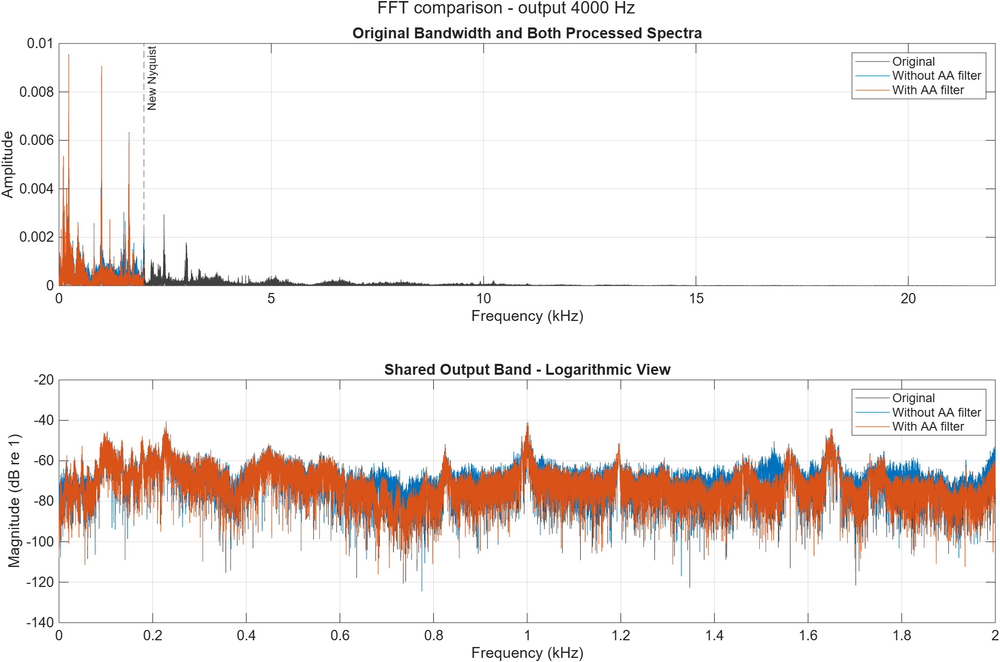

**Figure 12.** The upper panel shows the original bandwidth and marks the new Nyquist boundary at 2,000.0 Hz. Processed spectra stop at their own representable limits. The lower panel compares the shared output band in dB relative to amplitude 1.

This case retains the narrowest bandwidth. Curves differ in parts of the remaining band, while several strong low-frequency components remain. Components originally above 2 kHz can fold into the unfiltered output. Interpolation also affects amplitudes; a particular real-audio peak cannot be identified as an alias without a traceable source-frequency test.

### Interpreting the overlap

An aliased component appears inside the remaining band, not at its original out-of-band frequency. Filtering before rate reduction suppresses the high-frequency contribution. Original spectral content and the finite filter transition determine the observed differences. Magnitude overlap alone does not establish phase or waveform agreement.

## 4,000 Hz spectrogram comparison

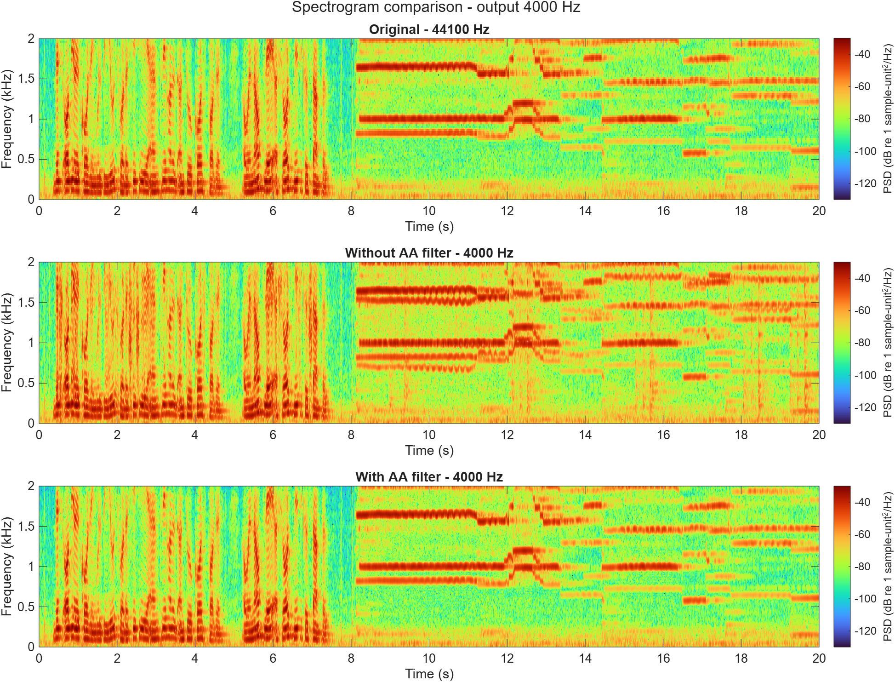

**Figure 13.** All rows use 30 ms Hamming windows, 20 ms overlap and 2,048 FFT points. The output Nyquist limit is 2,000.0 Hz. The unchanged original is displayed over the same output band as both processed rows, with equal color limits. Original frequencies above that limit remain visible in the full-band FFT figure.

Horizontal bands indicate sustained components. Changes over time indicate changing spectral content. Compare matching time-frequency locations within the output band. These views complement the FFT comparisons, but cannot independently identify the source frequency of every output feature.

Color values are numeric power spectral density, not calibrated acoustic dB SPL. Smaller rate means fewer samples in a 30 ms window; window durations, rather than sample counts, are matched across cases.

## Handoff and verification

| Artifact | Contents |
| --- | --- |
| sampling_all_rates.mat | Original and eight exact double-valued sampling cases with timing, methods and FIR coefficients. |
| case_manifest.csv | Eight unique IDs with rates, ratios, counts, durations and WAV metadata. |
| Eight named WAV files | Mono playback copies at their actual rates in 16-bit PCM carriers. |
| Thirteen PNG figures | Four waveform, four FFT and four spectrogram comparisons, plus the aliasing demonstration. |
| aliasing_summary.csv | Measured peak frequencies and amplitudes. |
| sha256_manifest.csv | Reference, source-code and result checksums. |

### Load one case from the repository root

```matlab
data = load("Results/Abdulrahman/Sampling/sampling_all_rates.mat");
entry = data.samplingHandoff.cases(6); % 8 kHz, filtered
samples = entry.samples;
Fs = entry.Fs;
```

Cases 1/2 are 22.05 kHz none/lpf; 3/4 are 11.025 kHz; 5/6 are 8 kHz; 7/8 are 4 kHz. Khaled should quantize the MAT arrays while preserving their timing/rates. Jesher should use the saved inverse ratio to reconstruct before quality comparisons. The handoff README contains run instructions.

### Checks performed

MATLAB verified the reference, case inventory, actual rates, expected counts, finite mono-column samples, declared processing results, duration bounds, reconstruction coverage, WAV rate/length/PCM width/bytes and conversion error. The existing 300 Hz tone retained its 300 Hz dominant frequency and zero diagnostic residual lag in all eight reconstructed paths; no lag correction was applied. Python independently checked eight WAV headers and the inventory. The largest WAV round-trip error was 3.0517304e-05, below one 16-bit PCM step (1/32,768).

No independent amplitude normalization or clipping was applied. WAV conversion error measures export rounding, not total downsampling degradation. Speaker playback and listening impressions require the team's actual listening session.

## Conclusion and remaining integration

All four lower rates are implemented in MATLAB with explicit filtered and unfiltered methods. The known 10 kHz recording folds to 1,025 Hz at 11.025 kHz sampling. Filtering reduces its measured largest residual by 68.74 dB. Comparable real-recording waveforms, FFTs and spectrograms show retained bandwidth and processing differences.

The 8 and 4 kHz unfiltered paths use linear interpolation, with a frequency-response effect of its own. A matching Simulink implementation must reproduce that method or explain a different interpolation choice. Integer FIR Decimation alone cannot supply the non-integer conversions.

### Remaining integration

Abdulrahman will complete the remaining Simulink cases and comparisons. Khaled will apply reduced bit depths. Jesher will complete the NMSE/SNR tables, final audio package and listening evaluation. Yazan will merge the report sections and acquisition evidence. Eight MATLAB sampling cases do not establish that the full combined case matrix is complete.

### Sources and references

[1] CCEN 302 Project-3.pdf, sampling/aliasing requirements and report deliverables.

[2] Matlab/FirstPart_AudioFreqAnalysis.m, Yazan's original analysis.

[3] Matlab/Sampling_Abdulrahman.m and Results/Abdulrahman/AA02.

[4] Matlab/Sampling_OtherRates.m, all three remaining MATLAB rates.

[5] Matlab/Aliasing_Demo.m and Audios/10kHz_Sine.wav.

[6] Results/Abdulrahman/Sampling, case_manifest.csv, aliasing_summary.csv and reproducible packaging/plot/check scripts in Matlab.

[7] Results/Abdulrahman/AA03/known_tone_validation.csv; Matlab/Compare_Sampling.m; dated verification in team/Abdulrahman.md.

Official API descriptions: [resample](https://www.mathworks.com/help/signal/ref/resample.html), [interp1](https://www.mathworks.com/help/matlab/ref/interp1.html), [fft](https://www.mathworks.com/help/matlab/ref/fft.html), [spectrogram](https://www.mathworks.com/help/signal/ref/spectrogram.html). Numeric results use local MATLAB R2026a. Full file hashes are in sha256_manifest.csv.
