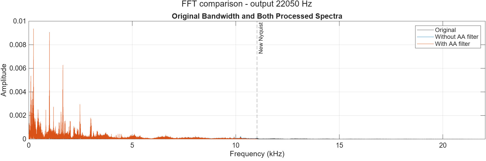
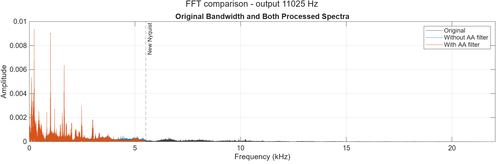
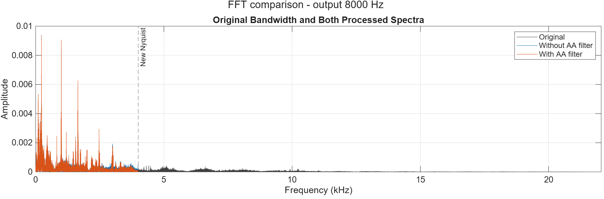
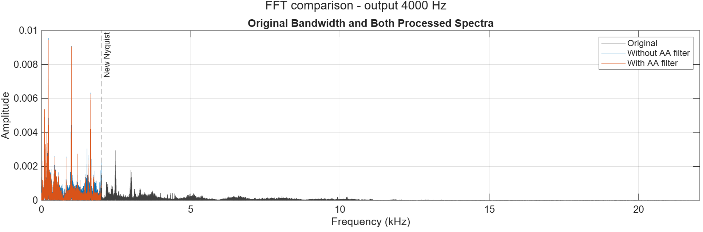

# Task 2: Sampling Rate Reduction and Aliasing

## Task 2: Downsampling and aliasing

Abdulrahman Junaid | CCEN 302 | 5 November 2026

The objective was to reduce the sampling rate of the same speech/music recording and compare conversion with and without an anti-aliasing (AA) low-pass filter. The original recording contains 882,005 mono samples at 44.1 kHz in a 16-bit PCM WAV file, approximately 20 seconds long. Acquisition and baseline analysis are described in Task 1.

Why aliasing occurs

Sampling rate is the number of measurements taken each second. The Nyquist limit is half that rate: fN = Fs/2. To avoid aliasing, the signal must be sufficiently band-limited below this limit. Otherwise, different continuous frequencies can produce the same samples, and high-frequency energy appears at a lower frequency. This false lower-frequency content is called aliasing.

An AA low-pass filter suppresses frequencies above the new usable band before samples are removed. Filtering after downsampling cannot separate an alias from genuine content at the same frequency. Practical filters have a transition band and finite attenuation, rather than a perfect cutoff.

| Output rate (Hz) | Nyquist (Hz) | Ratio p/q | Samples/path |
| --- | --- | --- | --- |
| 22050 | 11025 | 1/2 | 441003 |
| 11025 | 5512.5 | 1/4 | 220502 |
| 8000 | 4000 | 80/441 | 160001 |
| 4000 | 2000 | 40/441 | 80001 |

Controlled comparison

Every branch starts from the unchanged original recording. There is no independent amplitude normalization or reduced-bit quantizer in these sampling tests. The MAT files retain double-valued processing samples; the 16-bit label identifies the source/control, and exported WAVs use a 16-bit PCM container. Export rounding is separate from the sampling effect.

The evidence combines real-audio waveform, FFT and spectrogram comparisons with an existing known-frequency tone. The tone makes frequency folding identifiable; the real recording demonstrates the effect on a complex signal.

## 2.1 MATLAB methods and analysis

Integer and non-integer conversion

```matlab
yNoFilter = x(1:2:end);       % 22.05 kHz
yNoFilter11025 = x(1:4:end);  % 11.025 kHz
```

Starting at index 1 keeps the first sample at t = 0. These branches retain every second or fourth sample without a dedicated AA filter. They are played and plotted using their actual lower sampling rates; changing only a rate label would change playback speed.

```matlab
[p, q] = rat(FsOutput / Fs);
yNoFilterRate = interp1(originalTime, x, outputTime, "linear");
```

For 8 and 4 kHz, the ratios are 80/441 and 40/441. A constant integer indexing step cannot produce those exact rates. The code estimates samples at uniform target times by linear interpolation between adjacent source samples. Linear interpolation has a frequency response of its own; it is not an ideal transparent operation. Differences from the filtered path therefore include interpolation effects as well as AA filtering.

```matlab
[yFilteredRate, coefficientsRate] = resample(x, p, q, 10, 5);
```

The filtered branch uses a Kaiser-window FIR design with n = 10 and beta = 5. MATLAB resample compensates its filter delay. The filters have 41, 81, 8,821 and 8,821 taps at the four respective rates. For rational conversion, the coefficients apply at the intermediate rate p times the input rate; polyphase processing avoids explicitly constructing a large zero-inserted signal.

Fair plots and time alignment

Waveforms use actual sample times and common amplitude limits. FFT magnitudes are divided by sample count; positive-frequency pairs are doubled, except DC and an exact Nyquist bin. Amplitude dB means 20 log10(A/1). A display floor of 1e-12 avoids log10(0), without modifying audio samples.

Spectrograms use approximately 30 ms Hamming windows, 20 ms overlap and 2,048 FFT points at every rate. Color limits are shared: -130 to -30 dB relative to 1 sample-unit squared/Hz. A kHz horizontal or vertical frequency label does not change PSD units from per Hz to per kHz. Zero-padding increases plotted grid density, not true frequency resolution.

For later quality evaluation, resampling back to 44.1 kHz restores a common time grid, not lost information. The full original sample interval is retained, without optimized time shifts or error-based edge trimming. Boundary effects remain in the comparison.

## 2.2 Real-audio frequency comparisons

Figure 2.1. 22,050 Hz output: original and both processing paths; dashed line marks the new Nyquist limit. Amplitude scale is linear.



Figure 2.2. 11,025 Hz output: original and both processing paths; dashed line marks the new Nyquist limit. Amplitude scale is linear.



Figure 2.3. 8,000 Hz output: original and both processing paths; dashed line marks the new Nyquist limit. Amplitude scale is linear.



Figure 2.4. 4,000 Hz output: original and both processing paths; dashed line marks the new Nyquist limit. Amplitude scale is linear.



The largest original components lie at low frequencies, so the strongest peaks often overlap after filtering. This does not mean filtering is unnecessary: weaker high-frequency content can still fold into the retained band. At 4 kHz, only the band below 2 kHz remains available, making bandwidth loss and method differences more consequential.

These full-band views locate the removed bandwidth. Full-resolution shared-band dB views are supplied in the results folder for inspecting smaller differences. Individual peaks in speech/music cannot reliably be assigned an alias origin without a known-frequency reference.

## 2.3 Reading the time-frequency evidence

Figure 2.5. At 4 kHz, the full waveform preserves the broad time envelope while the common short-time zoom reveals local differences.


Figure 2.6. Original, unfiltered and filtered signals shown over the same 0-2 kHz band with common PSD color limits.


The envelope describes when the recording is loud or quiet; it does not establish that fine detail is preserved. Horizontal spectrogram bands represent sustained components, while short vertical changes indicate time-local activity. Shared axes and color limits prevent a rescaled display from hiding processing differences.

Above-band original content is visible in Figure 2.4, not in this deliberately shared-band spectrogram. The 4 kHz output cannot retain that original high-frequency information faithfully. Appendix A supplies corresponding waveform and spectrogram views for the other three rates.

## 2.4 A directly identifiable alias

Figure 2.7. Existing 10 kHz sine: original, unfiltered reduction to 11.025 kHz, and filtered reduction on comparable amplitude scales.


The new Nyquist limit is 5,512.5 Hz, so the 10 kHz tone lies above it. Sampling at 11,025 Hz makes it indistinguishable from a 1,025 Hz tone:

Predicted alias = |10,000 - 11,025| = 1,025 Hz.

| Path | Measured peak (Hz) | Peak amplitude |
| --- | --- | --- |
| original | 10000 | 0.12497299 |
| none | 1025 | 0.12497299 |
| lpf | 1025 | 4.5683239e-05 |

The unfiltered peak agrees with the prediction and retains approximately the original amplitude. With filtering, the largest measured residual is much smaller. The suppression is 20 log10(Aunfiltered/Afiltered) = 68.74 dB. This is measured residual suppression for this tone, not a general SNR improvement or a claim of perfect rejection.

The known tone establishes frequency folding unambiguously. Together with the real recording, it supports both the theoretical explanation and the practical comparison required by the project.

## 2.5 Simulink implementation and agreement

Equivalent sampling branches

```matlab
44.1 kHz source -> Downsample (2 or 4) -> unfiltered log
               -> FIR Decimation     -> filtered log

44.1 kHz source -> Linear interpolation -> unfiltered log
               -> FIR Rate Conversion -> filtered log
                  L/M = 80/441 or 40/441
```

The integer models use the same selection offset and FIR coefficients as MATLAB. The 8/4 kHz models use 4,410-sample input frames: interpolation produces 800/400 samples, and FIR Rate Conversion uses the matching rational ratio. These saved models were run in R2026a for 20 seconds.

Logged frames were flattened into sample columns. The known FIR delay of 10 output samples was removed from each filtered branch, and surplus final-frame samples were discarded to match the exact reference interval. This corrects implementation timing; it does not optimize the result to conceal signal degradation.

| Rate (Hz) | Filter | Delay removed | Max abs difference |
| --- | --- | --- | --- |
| 22050 | none | 0 | 0 |
| 22050 | lpf | 10 | 3.33e-16 |
| 11025 | none | 0 | 0 |
| 11025 | lpf | 10 | 5.55e-16 |
| 8000 | none | 0 | 1.68e-11 |
| 8000 | lpf | 10 | 7.77e-16 |
| 4000 | none | 0 | 1.32e-11 |
| 4000 | lpf | 10 | 6.66e-16 |

All eight cases pass: tolerance 1e-10 without filtering and 1e-12 with filtering. At 8/4 kHz, frame-relative and whole-record interpolation use slightly different floating-point arithmetic. Filtered differences are at rounding scale. These results establish MATLAB/Simulink agreement; they are not NMSE or SNR against the original recording.

The source-connected FFT/spectrogram displays show the original signal, not the logged processed branches. Frame FFTs also differ from a full-record FFT. With 4,410-sample frames, the final frame contains only five real samples followed by padding, so its small broad spectrum is not representative of the whole recording.

```matlab
% From repository root, reproduce the saved-model comparison:
addpath("Matlab")
Compare_All_Sampling
```

## 2.6 Discussion and conclusion

What the experiment establishes

Reducing the rate lowers the maximum usable bandwidth. Anti-aliasing filtering deliberately removes above-band content before conversion so it does not reappear as false lower-frequency content. The 10 kHz test provides the clearest evidence: the predicted and measured alias are both 1,025 Hz, and filtering strongly suppresses the residual.

The real-audio comparisons show why a waveform alone is insufficient. A similar overall envelope can coexist with lost bandwidth and changed spectral detail. At higher output rates, filtered and unfiltered curves can nearly overlap because the recording has relatively little energy in the affected band. At 4 kHz, preserving only frequencies below 2 kHz imposes a stronger limitation.

Limitations and handoff

The unfiltered rational-rate branches use linear interpolation, so their differences cannot be attributed exclusively to filtering. FIR filters also have finite transition bands and attenuation. Reconstructing to the original rate supports a valid time-grid comparison but cannot reverse aliasing or restore removed frequencies. No independent normalization was used.

The sampling handoff contains eight MATLAB controls and eight aligned Simulink controls with actual rates and timing metadata. Reduced-bit quantization, total NMSE/SNR, storage and case-specific listening interpretations are reported in the corresponding team sections. Abdulrahman reports that listening checks were completed; no unsupplied subjective observations are asserted here.

Conclusion

All four requested lower rates were implemented with both filter modes, and all eight platform comparisons passed their declared tolerances. The known-tone result confirms frequency folding predicted by sampling theory, with 68.74 dB measured suppression of the largest residual after filtering. The evidence demonstrates the need to filter before reduction while preserving the distinction between bandwidth loss, aliasing and numerical implementation error.

References and reproducibility

[1] CCEN 302 Project-3.pdf, sampling/aliasing requirements and grading criteria. [2] Project source: Sampling_Abdulrahman.m, Sampling_OtherRates.m, Aliasing_Demo.m and Compare_All_Sampling.m. [3] Saved evidence: case_manifest.csv, aliasing_summary.csv, alignment_checks.csv and simulink_comparison.csv in Results/Abdulrahman/Sampling. Measurements were produced in MATLAB/Simulink R2026a; this report revision reuses those results.

[4] MathWorks documentation: resample (mathworks.com/help/signal/ref/resample.html), interp1 (mathworks.com/help/matlab/ref/interp1.html), fft (mathworks.com/help/matlab/ref/fft.html), and spectrogram (mathworks.com/help/signal/ref/spectrogram.html).

## Appendix A: 22,050 Hz comparisons

Figure A22050-1. Full waveform and common short-time zoom. Original and both processing paths use matching amplitude/time conventions.


Figure A22050-2. Original, unfiltered and filtered PSD on the shared 0-11.025 kHz band, with the settings stated in Section 2.1.


These supporting plots complete the time-domain and time-frequency evidence across all four requested output rates. Full-resolution FFT plots, including shared-band dB views, remain in the reproducible results folder.

## Appendix A: 11,025 Hz comparisons

Figure A11025-1. Full waveform and common short-time zoom. Original and both processing paths use matching amplitude/time conventions.


Figure A11025-2. Original, unfiltered and filtered PSD on the shared 0-5.5125 kHz band, with the settings stated in Section 2.1.


These supporting plots complete the time-domain and time-frequency evidence across all four requested output rates. Full-resolution FFT plots, including shared-band dB views, remain in the reproducible results folder.

## Appendix A: 8,000 Hz comparisons

Figure A8000-1. Full waveform and common short-time zoom. Original and both processing paths use matching amplitude/time conventions.


Figure A8000-2. Original, unfiltered and filtered PSD on the shared 0-4 kHz band, with the settings stated in Section 2.1.


These supporting plots complete the time-domain and time-frequency evidence across all four requested output rates. Full-resolution FFT plots, including shared-band dB views, remain in the reproducible results folder.
