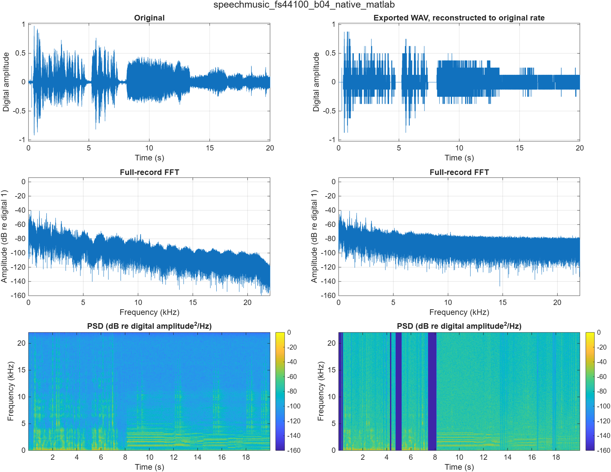
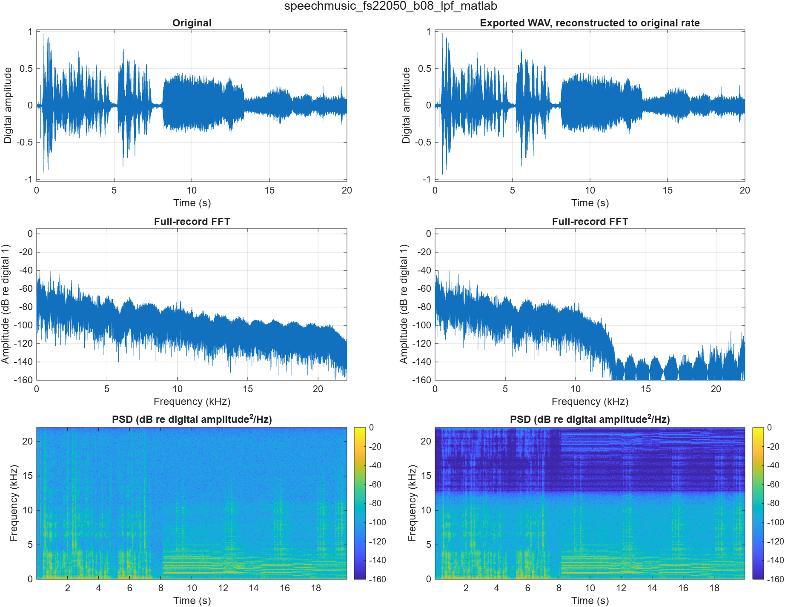
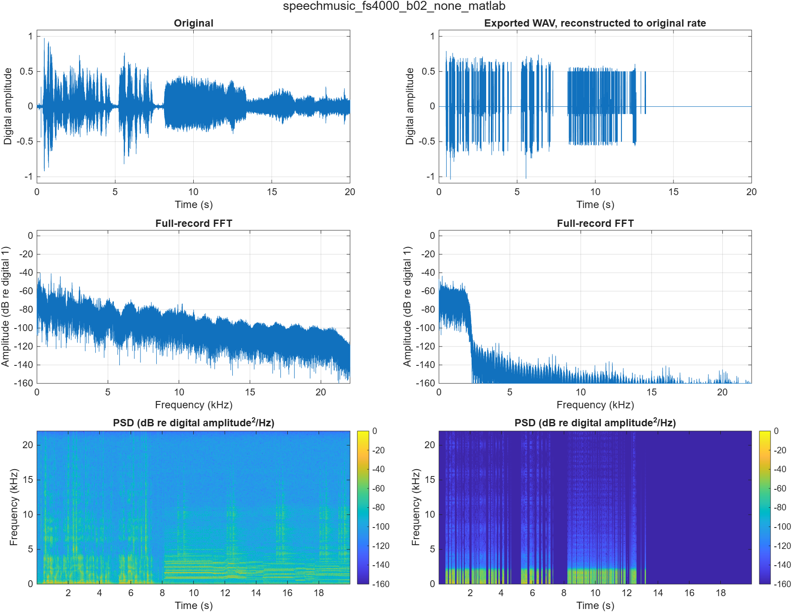

# Task 4: Quality evaluation of Khaled's processed audio

Measured run: `khaled_20261109_134921_849`; MATLAB 2026b. Insert Sections 4.1-4.7 after Khaled's quantization section. Table 4.1 may be moved to Appendix B.

## 4.1 Processed signals and responsibility

Abdulrahman supplies the sampling-stage arrays. Khaled's published Khaled_KH04_All_Cases script applies his MATLAB quantizer and his saved Khaled_Quantizer_Model Simulink design to those arrays. Jesher evaluates the resulting KH04_MATLAB_Cases.mat and KH04_Simulink_Cases.mat handoffs without replacing their samples. The producer code is from branch khaled-quantization-storage, commit fa2fc06. There are 36 cases per platform, with five rates, four precision settings and filtered/unfiltered lower-rate paths.

The native 44,100 Hz, 16-bit control retains all 882,005 original samples. Lower-rate cases use 22,050, 11,025, 8,000 or 4,000 Hz. Khaled uses uniform signed midtread levels with step 2/2^B for B = 8, 4 and 2, nearest-integer rounding with half ties away from zero, and saturation to the signed index range. The 16-bit setting bypasses additional quantization. Effective bits identify the producer setting and verified levels; they are not inferred from a WAV header.

## 4.2 Alignment and objective metrics

Each lower-rate output is reconstructed at 44,100 Hz using resample(samples,p,q,10,5), with the inverse sampling ratio. The first 882,005 reconstructed samples are compared with the original times from 0 through 882004/44100 seconds. Known sampling-filter delay is already compensated. There is no additional delay correction, independent amplitude normalization, optimized lag search or error-based edge trimming. Reconstruction restores the comparison grid, not lost bandwidth.

For error e[n] = x[n] - xhat[n], NMSE = sum(e.^2)/sum(x.^2), and SNR in dB = 10 log10(sum(x.^2)/sum(e.^2)). For positive finite energies, SNR = -10 log10(NMSE). The unchanged control has NMSE zero and infinite SNR. A silent reference with zero error has undefined normalized metrics, reported as NaN. Khaled's isolated quantization error compares the quantizer input/output at the processed rate; total NMSE/SNR additionally includes sampling and reconstruction errors.

The metrics CSV retains two representations: nmse/snrDb score Khaled's exact processing arrays, and exportedNmse/exportedSnrDb score the WAV after export, re-import and reconstruction. The following table uses exported-WAV scores throughout.

**Table 4.1. Total quality of Khaled's 72 outputs after Jesher's PCM16 WAV export and re-import.**

| Rate (Hz) | Bits | Filter | MATLAB NMSE | MATLAB SNR (dB) | Simulink NMSE | Simulink SNR (dB) |
| --- | --- | --- | --- | --- | --- | --- |
| 44100 | 16 | native | 0 | Inf | 0 | Inf |
| 44100 | 8 | native | 0.00046094993 | 33.3635 | 0.00046094993 | 33.3635 |
| 44100 | 4 | native | 0.10315971 | 9.8649 | 0.10315971 | 9.8649 |
| 44100 | 2 | native | 0.73678526 | 1.3266 | 0.73678526 | 1.3266 |
| 22050 | 16 | lpf | 0.00080722538 | 30.9301 | 0.00080722538 | 30.9301 |
| 22050 | 8 | lpf | 0.0012526762 | 29.0216 | 0.0012526762 | 29.0216 |
| 22050 | 4 | lpf | 0.10162094 | 9.9302 | 0.10162094 | 9.9302 |
| 22050 | 2 | lpf | 0.73291157 | 1.3495 | 0.73291157 | 1.3495 |
| 22050 | 16 | none | 0.0012201979 | 29.1357 | 0.0012201979 | 29.1357 |
| 22050 | 8 | none | 0.0016630983 | 27.7908 | 0.0016630983 | 27.7908 |
| 22050 | 4 | none | 0.10198279 | 9.9147 | 0.10198279 | 9.9147 |
| 22050 | 2 | none | 0.73297296 | 1.3491 | 0.73297296 | 1.3491 |
| 11025 | 16 | lpf | 0.013020025 | 18.8539 | 0.013020025 | 18.8539 |
| 11025 | 8 | lpf | 0.013470282 | 18.7062 | 0.013470282 | 18.7062 |
| 11025 | 4 | lpf | 0.11271896 | 9.4800 | 0.11271896 | 9.4800 |
| 11025 | 2 | lpf | 0.73121198 | 1.3596 | 0.73121198 | 1.3596 |
| 11025 | 16 | none | 0.023932078 | 16.2102 | 0.023932078 | 16.2102 |
| 11025 | 8 | none | 0.024377064 | 16.1302 | 0.024377064 | 16.1302 |
| 11025 | 4 | none | 0.12336245 | 9.0882 | 0.12336245 | 9.0882 |
| 11025 | 2 | none | 0.73625356 | 1.3297 | 0.73625356 | 1.3297 |
| 8000 | 16 | lpf | 0.025121936 | 15.9995 | 0.025121936 | 15.9995 |
| 8000 | 8 | lpf | 0.025564052 | 15.9237 | 0.025564052 | 15.9237 |
| 8000 | 4 | lpf | 0.12419085 | 9.0591 | 0.12419085 | 9.0591 |
| 8000 | 2 | lpf | 0.73466813 | 1.3391 | 0.73466813 | 1.3391 |
| 8000 | 16 | none | 0.043977836 | 13.5677 | 0.043977914 | 13.5677 |
| 8000 | 8 | none | 0.04445156 | 13.5211 | 0.044451401 | 13.5211 |
| 8000 | 4 | none | 0.14304754 | 8.4452 | 0.14304698 | 8.4452 |
| 8000 | 2 | none | 0.74301424 | 1.2900 | 0.74301424 | 1.2900 |
| 4000 | 16 | lpf | 0.12259258 | 9.1154 | 0.12259258 | 9.1154 |
| 4000 | 8 | lpf | 0.12303773 | 9.0996 | 0.12303773 | 9.0996 |
| 4000 | 4 | lpf | 0.21837744 | 6.6079 | 0.21837744 | 6.6079 |
| 4000 | 2 | lpf | 0.78461123 | 1.0535 | 0.78461123 | 1.0535 |
| 4000 | 16 | none | 0.2244979 | 6.4879 | 0.22449856 | 6.4879 |
| 4000 | 8 | none | 0.22500212 | 6.4781 | 0.2250044 | 6.4781 |
| 4000 | 4 | none | 0.31843017 | 4.9699 | 0.31842853 | 4.9699 |
| 4000 | 2 | none | 0.83459366 | 0.7852 | 0.83459366 | 0.7852 |

At 8/4 kHz, `none` uses linear interpolation without a dedicated anti-aliasing LPF. At 22.05/11.025 kHz, it uses direct sample selection. `lpf` denotes Abdulrahman's filtered rate conversion.

## 4.3 Waveform, FFT and spectrogram results

Each comparison shows the original at left and the exported processed WAV reconstructed to the original grid at right. Rows show waveform, normalized full-record single-sided FFT and PSD spectrogram. FFT scaling retains DC and treats odd/even sample counts correctly. Spectrograms use a periodic 1,024-sample Hann window, 768-sample overlap and 2,048-point FFT. The frequency axis is in kHz; PSD remains per Hz. Display floors are -160 dB.

Figure 4.1. Khaled's 44100 Hz, 4-bit, native output after WAV export and reconstruction. NMSE 0.10315971; SNR 9.8649 dB.

Figure 4.2. Khaled's 22050 Hz, 8-bit, lpf output after WAV export and reconstruction. NMSE 0.0012526762; SNR 29.0216 dB.

Figure 4.3. Khaled's 4000 Hz, 2-bit, none output after WAV export and reconstruction. NMSE 0.83459366; SNR 0.7852 dB.

Coarse quantization can map quiet samples to zero and remove small waveform variations. Unfiltered sampling reduction may fold higher-frequency content into the retained band. A narrow reconstructed spectrum alone does not establish that aliasing was prevented; interpret it with the processing method and Task 2's known-tone evidence.

## 4.4 Handoff acceptance and platform comparison

All 72 imported arrays were checked for exact equality with Khaled's saved handoffs. Rates, effective bits, platform, filter mode, timing, provenance and quantization-error identities were verified. Boundary fixtures independently check expected outputs at zero, half-step ties, range endpoints and out-of-range inputs in his MATLAB function and Simulink model. For identical inputs, the quantizers agree exactly.

The maximum upstream sampling difference is 1.67937469486e-11. There are 4 reduced-bit pairs with decision-boundary differences, involving 26 samples across those pairs. Each differing sample is exactly one quantization step apart and lies within upstream rounding distance of a half-step threshold. The integration comparison documents these explained differences. The evaluator's strict generic comparison remains available alongside this resolution.

### Why Khaled's published quality scores differ

Khaled's separate KH06 quality script uses linear interpolation with held endpoints. Jesher uses the documented resample-based full-record reconstruction. The same processed array can therefore give different total error energy. The next table compares processing-array scores only, avoiding WAV-conversion differences.

**Table 4.2. Reconstruction-method comparison for MATLAB sampling controls.**

| Rate (Hz) | Filter | Jesher resample NMSE | Jesher SNR (dB) | Khaled linear-hold NMSE | Khaled SNR (dB) |
| --- | --- | --- | --- | --- | --- |
| 22050 | lpf | 0.00080722247 | 30.9301 | 0.0031667542 | 24.9939 |
| 8000 | lpf | 0.025121932 | 15.9995 | 0.044421132 | 13.5241 |
| 4000 | lpf | 0.12259256 | 9.1154 | 0.18332998 | 7.3677 |

The complete [method comparison](../Results/Integrated/khaled_20261109_134921_849/reconstruction_comparison.csv) identifies both methods. Keep reconstruction methods labeled when copying report results.

## 4.5 Verified exports and storage

Each signal is exported as mono PCM16 at its actual rate, then read back. Conversion explicitly rounds samples times 32768 to signed 16-bit integers; no case normalization or silent clipping is applied. Rate, channels, sample count, file bytes and re-imported values are checked. The ZIP contains the unchanged original plus 72 processed WAVs and manifests. Archived bytes are verified against exported files.

Effective precision remains separate from file width. A 2-bit quantized signal has four amplitude levels, but its WAV uses a 16-bit carrier. Theoretical packed payload is ceil(N times B / 8) bytes for one channel. Actual PCM16 sample payload is 2N bytes, plus measured overhead. Reducing effective precision alone does not shrink this WAV container; reducing sample rate reduces its sample count.

For example, the filtered 22,050 Hz, 8-bit case occupies 882050 WAV bytes and has exported SNR 29.0216 dB. The [full storage table](../Results/Integrated/khaled_20261109_134921_849/storage_quality.csv) links every case to measured file size and theoretical payload.

## 4.6 Reported listening observations

Khaled's published worksheet records 9 tested cases on laptop speakers, with listener recorded as self; 63 cases remain not_tested. These observations concern his supplied worksheet and earlier exports, rather than a new Jesher playback session. Listening date and volume are not supplied. The table pairs the reported observations with Jesher's current exported-WAV scores.

**Table 4.3. Existing observations reported in Khaled's worksheet.**

| Case ID | Jesher exported SNR (dB) | Reported observation |
| --- | --- | --- |
| speechmusic_fs44100_b16_native_matlab | Inf | Speech is clear and easy to understand. |
| speechmusic_fs44100_b08_native_matlab | 33.3635 | Speech is clear and easy to understand. |
| speechmusic_fs44100_b04_native_matlab | 9.8649 | Speech is audible, but less easy to understand than before. |
| speechmusic_fs44100_b02_native_matlab | 1.3266 | Speech is not audible, and cannot be understood. |
| speechmusic_fs8000_b04_none_matlab | 8.4452 | Speech is audible, but less easy to understand than before. |
| speechmusic_fs8000_b04_lpf_matlab | 9.0591 | Speech is audible, but less easy to understand than before. |
| speechmusic_fs4000_b02_none_matlab | 0.7852 | Speech is not audible, and cannot be understood. |
| speechmusic_fs4000_b02_lpf_matlab | 1.0535 | Speech is not audible, and cannot be understood. |
| speechmusic_fs8000_b04_lpf_simulink | 9.0591 | Speech is audible, but less easy to understand than before. |

Native 8-bit speech is reported clear, native 4-bit speech less intelligible and native 2-bit speech not audible/understandable in that session. These reports accompany falling objective fidelity, but SNR does not set a universal audibility threshold. A reported inaudible clip does not establish that its digital samples are all zero. The [joined listening results](../Results/Integrated/khaled_20261109_134921_849/listening_results.csv) preserve the original observations and attribution. Additional notes require actual listening with the setup recorded.

## 4.7 Reproduction and report placement

Run RUN_PROJECT for sampling, Khaled's actual producer and Jesher's evaluation. Run RUN_JESHER to evaluate existing KH04 handoffs. For a single live case, edit PROJECT_SETTINGS, run RUN_DEMO and then PLAY_PROJECT_AUDIO. The demo checks that its output exactly matches Khaled's saved case. Use Figures 4.1-4.3 in this section; put full Table 4.1 in Appendix B if needed. A code appendix is optional. The shared Word report still needs assembly; this file supplies the evaluation text and captions. See [QUICK_START](../QUICK_START.md) for the file map.
