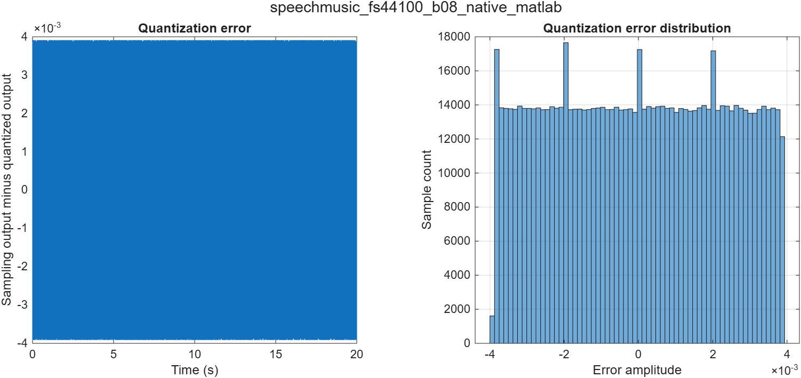
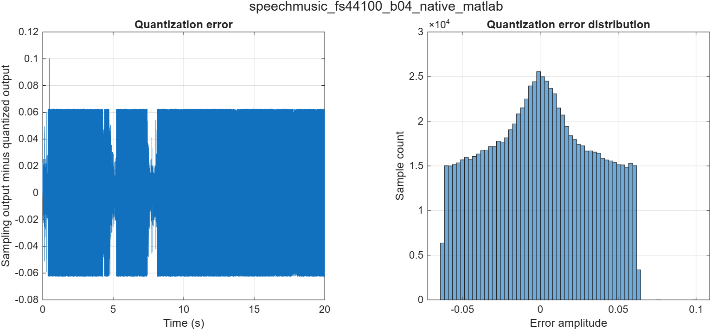
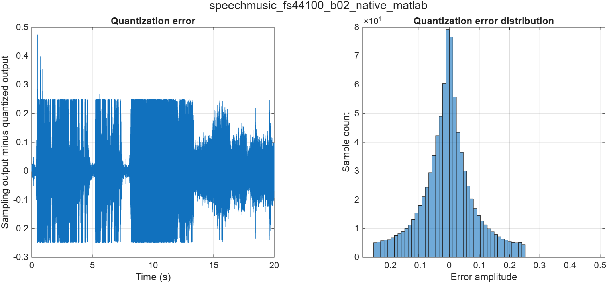
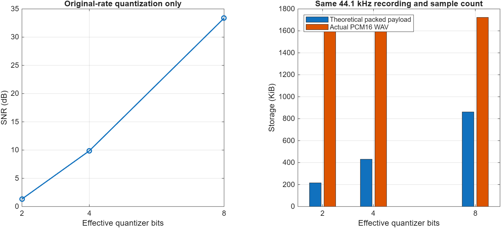
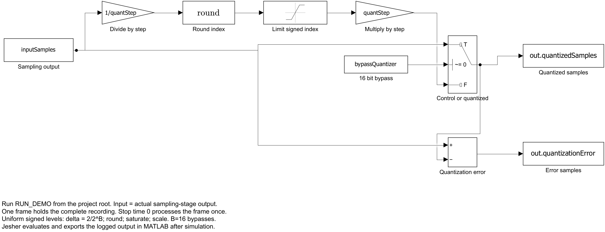
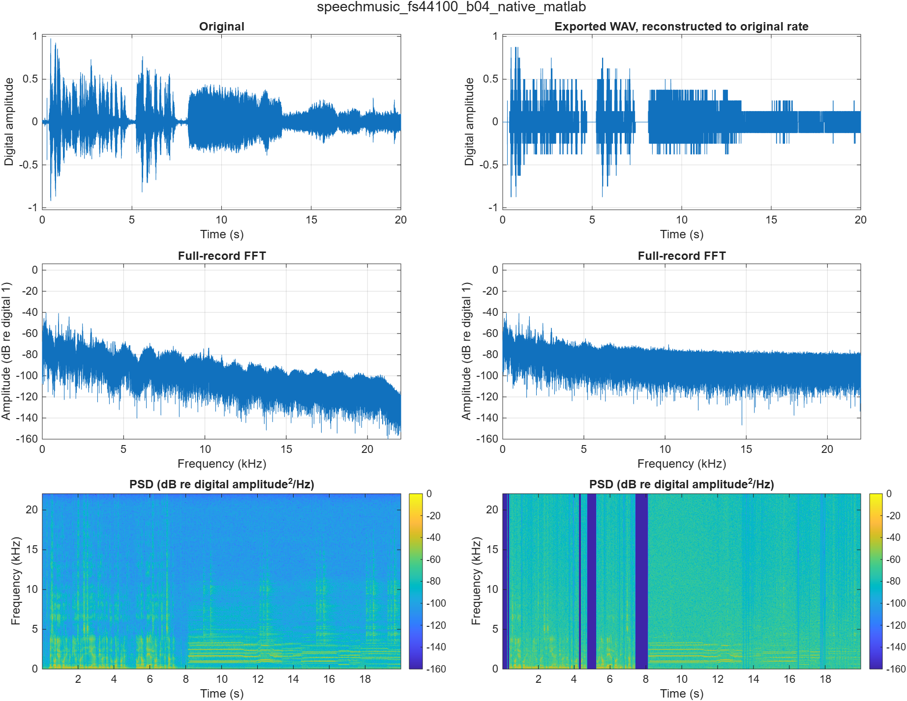
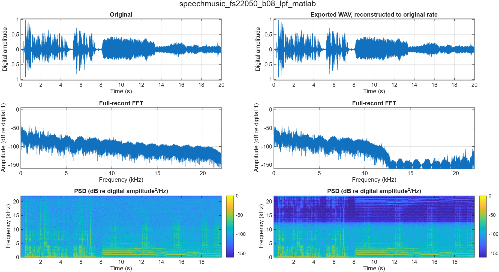
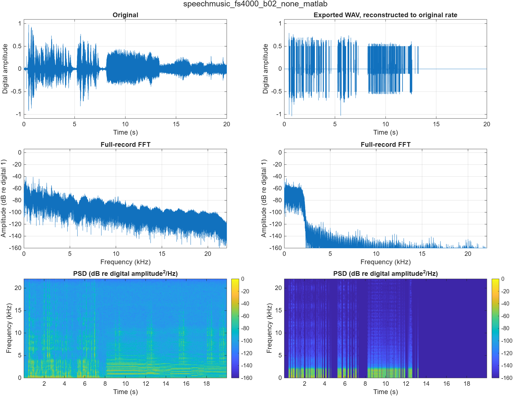

# Tasks 3 and 4: Quantization, storage and quality evaluation

Measured run: `run_20261109_125250_117`. MATLAB 2026b. Insert Task 3 after the existing sampling section, then Task 4. The full table can be placed in a results appendix.

This implementation completes the quantization stage at Jesher's request and connects it to Abdulrahman's actual MATLAB and Simulink sampling outputs. Jesher's evaluator measures those combined outputs. The earlier independent demo remains a separate experiment. The task labels identify team responsibilities; they do not claim independent authorship or approval by another student.

## 3.1 Uniform requantization

The mono original has 882,005 samples at 44,100 Hz and 16-bit PCM resolution. Sampling precedes quantization. At the native rate the quantizer receives the original samples. At lower rates it receives the exact double-valued sampling arrays, rather than the rounded WAV copies. The MATLAB quantizer receives MATLAB sampling outputs; the Simulink quantizer receives outputs from the four actual sampling models. No independent amplitude normalization is applied.

For B = 8, 4 or 2, the step is delta = 2/2^B. The algorithm rounds x/delta to the nearest integer, with exact half ties away from zero, limits the index to [-2^(B-1), 2^(B-1)-1], then multiplies by delta. There are 2^B available levels between -1 and 1-delta. For 2 bits the levels are -1, -0.5, 0 and 0.5. The 16-bit setting bypasses requantization and preserves the sampling-stage doubles as a control. No dither is added. Samples that would round beyond the largest signed index are saturated and counted.

## 3.2 Isolated quantization error

Quantization error is e_q[n] = samplingInput[n] - quantizedOutput[n]. Both arrays have the same rate and time origin. This isolates quantization from the total sampling/reconstruction error. The error histogram uses the full recording. The approximation delta^2/12 assumes unsaturated, approximately uniform rounding error; speech/music and coarse quantization need not satisfy it. Positive-end saturation can also exceed a half-step error.

**Table 3.1. Native-rate quantization of the actual recording, MATLAB.** No rate change or reconstruction filter is involved.

| Effective bits | Observed levels | Saturated samples | Error MSE | Mean error | Maximum absolute error | SNR (dB) |
| --- | --- | --- | --- | --- | --- | --- |
| 8 | 233 | 0 | 5.0857429e-06 | -2.3826066e-06 | 0.00390625 | 33.3635 |
| 4 | 15 | 2 | 0.0011381795 | -0.00019025357 | 0.10018921 | 9.8649 |
| 2 | 4 | 98 | 0.0081290833 | -0.0040694833 | 0.47518921 | 1.3266 |

Observed levels can be fewer than the available levels because the recording does not visit every amplitude.

At 8 bits, the measured error MSE is close to delta^2/12. The low-bit histogram is concentrated near zero rather than uniform, and its time variation follows the changing content of the recording. At 2 bits, many small input amplitudes map to zero. Saturation and the signal-dependent error distribution explain why an exact 6 dB improvement per added bit is not expected for every condition.

Figure 3.1. Native-rate 8-bit quantization error versus time and full-record error distribution. The error is original minus quantized samples, before WAV export.

Figure 3.2. Native-rate 4-bit quantization error versus time and full-record error distribution. The error is original minus quantized samples, before WAV export.

Figure 3.3. Native-rate 2-bit quantization error versus time and full-record error distribution. The error is original minus quantized samples, before WAV export.

## 3.3 Storage and effective precision

The ideal packed payload is N times B bits for one channel, or ceil(N times B / 8) whole bytes. This is a theoretical packing calculation, not an implemented low-bit file format. Every exported WAV is mono PCM16, so its actual sample payload is 2N bytes irrespective of effective quantizer bits. The table records measured file size and header overhead. Reducing the sampling rate reduces the WAV sample count; reducing effective precision alone does not shrink this PCM16 carrier.

**Table 3.2. Native-rate precision/storage comparison, MATLAB.** SNR is measured after WAV re-import.

| Bits | Ideal packed payload (bytes) | Actual WAV (bytes) | WAV container bits | SNR (dB) |
| --- | --- | --- | --- | --- |
| 16 | 1764010 | 1764054 | 16 | Inf |
| 8 | 882005 | 1764054 | 16 | 33.3635 |
| 4 | 441003 | 1764054 | 16 | 9.8649 |
| 2 | 220502 | 1764054 | 16 | 1.3266 |

Figure 3.4. Native-rate measured SNR and theoretical packed payload versus actual PCM16 WAV storage. The 16-bit zero-error control is excluded from the finite-SNR plot.

For a combined example, the filtered 22,050 Hz, 8-bit case uses 882050 actual WAV bytes, compared with 1764054 for the native control, and has exported SNR 29.0216 dB. The filtered 4,000 Hz, 2-bit case uses 160046 bytes but its SNR falls to 1.0535 dB. These examples quantify the rate/quality tradeoff in the actual exported files; further reducing effective bits at a fixed rate saves theoretical packed payload only. The [full storage-quality table](../Results/Integrated/run_20261109_125250_117/storage_quality.csv) includes every case and both metric representations.

## 3.4 Theory and platform implementation

The familiar full-scale sine approximation is SNR approximately 6.02B + 1.76 dB. For a sine with peak 0.5, its amplitude correction is 20 log10(0.5). It assumes high-resolution, unsaturated quantization and an appropriate error distribution. A separate 997 Hz, two-second sine checks the trend without sampling-rate reduction.

| Bits | Measured sine SNR (dB) | High-resolution prediction (dB) |
| --- | --- | --- |
| 8 | 44.0358 | 43.9051 |
| 4 | 20.3681 | 19.8227 |
| 2 | 8.9273 | 7.7815 |

The approximation becomes less reliable at very low precision. It is not a prediction of the combined sampling-plus-quantization SNR. The Simulink design implements divide, round, saturate and multiply using visible arithmetic blocks, with a control bypass and error output. One vector frame contains the entire recording; simulation stop time zero processes that frame once and does not mean zero-duration audio.

Figure 3.5. Actual Simulink quantization model. The input is the sampling-stage array; quantized samples and isolated quantization error are logged for evaluation.

## 4.1 Total quality measurement and alignment

For total degradation, the processed array is reconstructed at 44,100 Hz with resample(samples,p,q,10,5) using the inverse conversion ratio. The first 882,005 reconstructed samples are compared with the original times from 0 through 882004/44100 seconds. Known sampling-filter delay is already compensated. No extra time shift, gain normalization or error-selected edge trimming is applied. Reconstruction restores the time grid, not removed bandwidth or aliased information.

NMSE = sum((x - xhat).^2) / sum(x.^2). SNR in dB = 10 log10(sum(x.^2) / sum((x - xhat).^2)). The same positive-error comparison satisfies SNR = -10 log10(NMSE). The unchanged control has NMSE zero and infinite SNR. A silent reference with zero error has undefined normalized metrics, reported as NaN. The nmse/snrDb columns score processing arrays; exportedNmse/exportedSnrDb score the WAV after export, re-import and reconstruction.

## 4.2 Results across all conditions

There are four native-rate precision settings and four lower rates with two filter modes and four precision settings: 36 conditions per platform, 72 actual results. The following complete table reports exported-WAV results. The machine-readable metrics table also retains processing-array scores and timing/export metadata.

**Table 4.1. Complete combined results after PCM16 WAV re-import and reconstruction.**

| Rate (Hz) | Bits | Filter | MATLAB NMSE | MATLAB SNR (dB) | Simulink NMSE | Simulink SNR (dB) |
| --- | --- | --- | --- | --- | --- | --- |
| 44100 | 16 | native | 0 | Inf | 0 | Inf |
| 44100 | 8 | native | 0.00046094993 | 33.3635 | 0.00046094993 | 33.3635 |
| 44100 | 4 | native | 0.10315971 | 9.8649 | 0.10315971 | 9.8649 |
| 44100 | 2 | native | 0.73678526 | 1.3266 | 0.73678526 | 1.3266 |
| 22050 | 16 | lpf | 0.00080722538 | 30.9301 | 0.00080722538 | 30.9301 |
| 22050 | 8 | lpf | 0.0012526762 | 29.0216 | 0.0012526762 | 29.0216 |
| 22050 | 4 | lpf | 0.10162094 | 9.9302 | 0.10162094 | 9.9302 |
| 22050 | 2 | lpf | 0.73291157 | 1.3495 | 0.73291157 | 1.3495 |
| 22050 | 16 | none | 0.0012201979 | 29.1357 | 0.0012201979 | 29.1357 |
| 22050 | 8 | none | 0.0016630983 | 27.7908 | 0.0016630983 | 27.7908 |
| 22050 | 4 | none | 0.10198279 | 9.9147 | 0.10198279 | 9.9147 |
| 22050 | 2 | none | 0.73297296 | 1.3491 | 0.73297296 | 1.3491 |
| 11025 | 16 | lpf | 0.013020025 | 18.8539 | 0.013020025 | 18.8539 |
| 11025 | 8 | lpf | 0.013470282 | 18.7062 | 0.013470282 | 18.7062 |
| 11025 | 4 | lpf | 0.11271896 | 9.4800 | 0.11271896 | 9.4800 |
| 11025 | 2 | lpf | 0.73121198 | 1.3596 | 0.73121198 | 1.3596 |
| 11025 | 16 | none | 0.023932078 | 16.2102 | 0.023932078 | 16.2102 |
| 11025 | 8 | none | 0.024377064 | 16.1302 | 0.024377064 | 16.1302 |
| 11025 | 4 | none | 0.12336245 | 9.0882 | 0.12336245 | 9.0882 |
| 11025 | 2 | none | 0.73625356 | 1.3297 | 0.73625356 | 1.3297 |
| 8000 | 16 | lpf | 0.025121936 | 15.9995 | 0.025121936 | 15.9995 |
| 8000 | 8 | lpf | 0.025564052 | 15.9237 | 0.025564052 | 15.9237 |
| 8000 | 4 | lpf | 0.12419085 | 9.0591 | 0.12419085 | 9.0591 |
| 8000 | 2 | lpf | 0.73466813 | 1.3391 | 0.73466813 | 1.3391 |
| 8000 | 16 | none | 0.043977836 | 13.5677 | 0.043977914 | 13.5677 |
| 8000 | 8 | none | 0.04445156 | 13.5211 | 0.044451401 | 13.5211 |
| 8000 | 4 | none | 0.14304754 | 8.4452 | 0.14304698 | 8.4452 |
| 8000 | 2 | none | 0.74301424 | 1.2900 | 0.74301424 | 1.2900 |
| 4000 | 16 | lpf | 0.12259258 | 9.1154 | 0.12259258 | 9.1154 |
| 4000 | 8 | lpf | 0.12303773 | 9.0996 | 0.12303773 | 9.0996 |
| 4000 | 4 | lpf | 0.21837744 | 6.6079 | 0.21837744 | 6.6079 |
| 4000 | 2 | lpf | 0.78461123 | 1.0535 | 0.78461123 | 1.0535 |
| 4000 | 16 | none | 0.2244979 | 6.4879 | 0.22449856 | 6.4879 |
| 4000 | 8 | none | 0.22500212 | 6.4781 | 0.2250044 | 6.4781 |
| 4000 | 4 | none | 0.31843017 | 4.9699 | 0.31842853 | 4.9699 |
| 4000 | 2 | none | 0.83459366 | 0.7852 | 0.83459366 | 0.7852 |

Filter `none` at 8/4 kHz means linear interpolation without a dedicated anti-aliasing LPF. At 22.05/11.025 kHz it means direct sample selection. `lpf` uses Abdulrahman's documented filtered conversion.

## 4.3 Representative waveform, FFT and spectrogram comparisons

Each figure compares the original at left with the exported WAV reconstructed to the original grid at right. Rows show waveform, normalized full-record single-sided FFT and PSD spectrogram. FFT scaling retains DC and accounts for odd/even sample counts. Spectrograms use a periodic 1,024-sample Hann window, 768-sample overlap and 2,048-point FFT. The frequency axis is in kHz; PSD remains per Hz. Display floors are -160 dB. Quantization errors are plotted separately at the processed rate.

Figure 4.1. 44100 Hz, 4 effective bits, native path. Exported-WAV NMSE 0.10315971 and SNR 9.8649 dB.

Figure 4.2. 22050 Hz, 8 effective bits, lpf path. Exported-WAV NMSE 0.0012526762 and SNR 29.0216 dB.

Figure 4.3. 4000 Hz, 2 effective bits, none path. Exported-WAV NMSE 0.83459366 and SNR 0.7852 dB.

Coarse quantization removes many small-amplitude variations and can flatten quiet regions to zero. Lower-rate conversion removes or folds higher-frequency information depending on the filter path. A narrow reconstructed spectrum alone does not prove that aliasing was avoided before rate conversion; interpret it with the sampling method and the known-tone checks in Task 2.

## 4.4 MATLAB and Simulink agreement

Identical-input quantizer checks passed exactly for all actual Simulink cases and explicit boundary fixtures. The largest actual sampling-stage difference across the 36 platform pairs was 1.67937469486e-11. The combined outputs contain 4 pairs with quantizer decision-boundary differences, involving 26 samples in total across those pairs. Each such difference is exactly one quantizer step and is verified to originate from input roundoff at a half-step threshold. The complete resolved comparison is integration_comparison.csv. The original evaluator's stricter generic comparison is retained for transparency.

The integration checks also verify all 72 unique identities, timing/rates, unchanged controls, quantizer level limits, isolated errors, WAV sample counts and PCM representations. The evaluator verifies the ZIP members byte for byte against its manifest. Numerical checks do not constitute human listening or peer sign-off.

## 4.5 Playback and remaining human observations

RUN_DEMO exports a selected case. PLAY_PROJECT_AUDIO plays the original followed by that WAV at their actual rates, without independent level normalization. The new full matrix has no recorded human listening observations yet. The supplied listening_template.csv links every case to its exported NMSE/SNR and leaves listener, device/volume and observations blank. Earlier observations that three sampling-control clips sounded clear do not establish the audibility of these new reduced-bit outputs. Students still need to listen, record actual observations, rehearse the explanation and complete final report/package approval.

## 4.6 Code and report placement

Use RUN_PROJECT for the full run and PROJECT_SETTINGS plus RUN_DEMO for the live case. See [QUICK_START](../QUICK_START.md) for the simple file map. Use Figures 3.1-3.5 and 4.1-4.3 in the corresponding sections as space permits. Table 4.1 can be moved to Appendix B with a cross-reference in Section 4.2. Additional comparison images and the complete storage CSV are supporting results; a separate code appendix is optional. The shared Word report has not been edited by this generated section. Preserve the earlier sampling content and add these sections after it.
